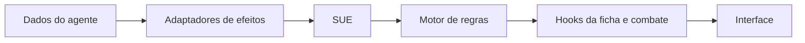
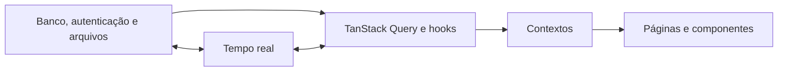

# Let's Roll — VTT para Ordem Paranormal RPG

<div align="center">


**Ficha digital, campanhas em tempo real e mapa tático em uma única plataforma.**

[Acessar o Let's Roll](https://ficha-paranormal.lovable.app) · [Instalar como aplicativo](https://ficha-paranormal.lovable.app/install) · [Documentação técnica](#documentação-técnica)

</div>

---

## Sobre o projeto

O **Let's Roll** é uma mesa virtual (VTT) para criar agentes, administrar fichas e conduzir campanhas de **Ordem Paranormal RPG**. A plataforma reúne automações de ficha, rolagens, combate, rituais, inventário, comunicação entre participantes e um mapa tático colaborativo.

O projeto busca reduzir cálculos repetitivos sem retirar do mestre e dos jogadores o controle das decisões. As mecânicas implementadas são organizadas em torno do **Livro Base v1.3** e dos conteúdos oficiais cadastrados no sistema.

> [!IMPORTANT]
> Este é um projeto de fã não oficial. Ordem Paranormal e suas propriedades pertencem aos respectivos autores e detentores de direitos. O Let's Roll não substitui os livros oficiais.

## Conteúdo

- [Experiência de jogo](#experiência-de-jogo)
- [Ficha de agente](#ficha-de-agente)
- [Regras, rolagens e combate](#regras-rolagens-e-combate)
- [Campanhas](#campanhas)
- [Mapa tático](#mapa-tático)
- [Templates e administração](#templates-e-administração)
- [PWA e experiência mobile](#pwa-e-experiência-mobile)
- [Arquitetura](#arquitetura)
- [Tecnologias](#tecnologias)
- [Execução local](#execução-local)
- [Qualidade e segurança](#qualidade-e-segurança)
- [Documentação técnica](#documentação-técnica)
- [Contribuição](#contribuição)

---

## Experiência de jogo

O Let's Roll oferece dois contextos conectados:

### Modo Ficha

Criação, consulta e progressão de agentes, com atributos, perícias, origem, classe, trilha, poderes, rituais, equipamentos e condições reunidos na ficha digital.

### Modo Mestre

Criação e condução de campanhas com participantes, sessões, chat, notas, handouts, áudio, iniciativa e mapa tático sincronizados em tempo real.

## Ficha de agente

### Criação e progressão

- fluxo guiado de criação de personagem;
- atributos **Agilidade, Força, Intelecto, Presença e Vigor**;
- classes **Combatente, Especialista e Ocultista**;
- origens, perícias e trilhas registradas no catálogo do projeto;
- seleção de poderes com validação de pré-requisitos;
- progressão por NEX e visualização da evolução da ficha;
- auditoria de inconsistências e correções assistidas;
- salvamento e clonagem de personagens.

### Inventário

- catálogos de armas, proteções, munições, acessórios e itens;
- controle de categoria, espaços e carga;
- equipamentos e itens carregados;
- modificações próprias para armas, munições, proteções e acessórios;
- bloqueio de uma modificação já aplicada ao mesmo item;
- itens amaldiçoados cadastrados separadamente;
- interface adaptada para desktop e celular.

### Rituais e condições

- catálogo unificado de rituais;
- círculos, elementos e formas aprimoradas;
- validação de conjuração e custo de PE;
- controle de rituais sustentados;
- efeitos de dano, cura, bônus e condições conectados ao motor de regras;
- condições ativas com parâmetros, duração e efeitos mecânicos cadastrados.

## Regras, rolagens e combate

### Sistema Unificado de Efeitos (SUE)

O SUE centraliza efeitos provenientes de origem, classe, trilha, poderes, rituais, condições e equipamentos. Ele consolida os modificadores antes de entregar o resultado aos recursos de ficha e combate.

Principais responsabilidades:

- preparação e consolidação de efeitos;
- ordem determinística de aplicação;
- regras de acumulação de bônus;
- rastreamento das fontes aplicadas e excluídas;
- integração entre o estado do personagem e o motor de regras.

### Sistema de Rolagem Unificado

Rolagens com contexto de personagem passam pelos adaptadores do SUE:

- testes de perícia;
- ataques e dano;
- iniciativa;
- Fortitude, Reflexos e Vontade;
- dano de rituais.

Os resultados podem apresentar os dados rolados, o dado mantido, modificadores, total e fontes dos bônus. Ataque e dano permanecem etapas distintas.

### Recursos de combate

- painel de armas e ações de combate;
- iniciativa, rodadas e turnos;
- estados de ação e reações preparadas;
- dano, cura e condições;
- bônus temporários em armas;
- rituais ativos e sustentados;
- ataques de oportunidade;
- alcance e movimentação;
- macros e histórico de rolagens;
- sincronização de informações entre ficha, campanha e tabuleiro.

> [!NOTE]
> Rolagens livres do chat, sem personagem associado, usam o rolador independente. Rolagens da ficha usam o contexto do personagem e o SUE.

## Campanhas

### Organização

- criação guiada de campanha;
- papéis separados para mestre e jogadores;
- associação de personagens à campanha;
- convites para participantes;
- lista e presença de membros;
- sessões com início, encerramento e histórico;
- diário e linha do tempo da campanha;
- exportação de registros de sessão.

### Comunicação e materiais

- chat da campanha em tempo real;
- rolagens integradas ao chat;
- mensagens privadas entre destinatário e mestre;
- registro de atividades da sessão;
- notas públicas e privadas;
- handouts para os jogadores;
- feed de rituais;
- reprodução e sincronização de áudio;
- notificações de eventos da campanha.

### Ferramentas do mestre

- gestão de participantes e personagens;
- NPCs da campanha;
- condições e bônus dos membros;
- controle de iniciativa e turnos;
- macros compartilhadas;
- gerenciamento de materiais e assets;
- pausa tática e câmera sincronizada no mapa.

## Mapa tático

O mapa abre em uma rota dedicada (`/map/:id`) e utiliza **Konva** com camadas de renderização especializadas.

### Tabuleiro e câmera

- mapas múltiplos por campanha;
- grade e ajuste de escala;
- zoom, pan e enquadramento;
- sincronização opcional da câmera;
- modo de tela cheia;
- atalhos de teclado.

### Tokens e interação

- tokens de personagem e NPC;
- arrastar e soltar com atualização otimista;
- ajuste de tamanho dos tokens;
- suporte a tokens animados;
- seleção, movimentação e medição;
- indicadores e estados conectados ao combate.

### Ferramentas de cena

- desenho livre e texto;
- névoa de guerra;
- pings temporários e pings avançados;
- marcadores persistentes no mapa;
- áreas de efeito manipuláveis;
- gerenciamento de imagens, tokens, mapas, áudio e handouts.

## Templates e administração

### Templates de personagem

- galeria de templates;
- filtros, pré-visualização e avaliações;
- criação, edição e clonagem;
- assistente para aplicar um template;
- roteiro visual de progressão;
- área de templates do próprio usuário.

### Administração

As rotas administrativas são protegidas por perfil de acesso e incluem:

- importação e pré-visualização de dados;
- gestão de usuários e campanhas;
- verificação de integridade dos dados;
- painéis de validação de regras;
- diagnóstico e cobertura do SUE;
- métricas e registros de auditoria.

## PWA e experiência mobile

O Let's Roll pode ser instalado como aplicativo em navegadores compatíveis.

- manifesto PWA e ícones próprios;
- atualização automática do service worker;
- indicação de estado offline;
- cache de recursos estáticos e fontes;
- fallback de navegação para a aplicação e o mapa;
- notificações push;
- avisos de instalação e de atualização;
- ficha, inventário, rolagens e combate adaptados para telas menores;
- drawers e folhas de ação para interações mobile.

O modo offline é limitado aos recursos já armazenados no dispositivo. A sincronização de campanha continua dependendo de conexão.

---

## Arquitetura

```text
src/
├── components/          Interface organizada por domínio
│   ├── admin/           Administração e auditoria
│   ├── campaign/        Campanha, chat, mapa, sessões e mestre
│   ├── character/       Ficha, criação, progressão e trilhas
│   ├── combat/          Combate e controle de turnos
│   ├── dice/            Rolagens e histórico
│   ├── inventory/       Inventário e modificações
│   ├── templates/       Galeria e aplicação de templates
│   └── ui/              Componentes visuais reutilizáveis
├── contexts/            Autenticação, ficha e tema
├── hooks/               Estado e integrações por domínio
│   ├── campaign/        Recursos colaborativos da campanha
│   ├── character/       Estado e persistência da ficha
│   ├── combat/          Fluxos de combate
│   └── sue/             Adaptadores de rolagem para o SUE
├── lib/                 Regras e dados independentes da interface
│   ├── catalogs/        Armas, proteções, itens e maldições
│   ├── class-powers/    Classes, poderes e trilhas
│   ├── conditions/      Condições e acumulação
│   ├── constants/       IDs oficiais centralizados
│   ├── effects/         Adaptadores de efeitos
│   ├── rituals/         Catálogo e execução de rituais
│   ├── rules-engine/    Derivação, validação e rolagens
│   └── sue/             Ordem e consolidação dos efeitos
├── pages/               Páginas e pontos de entrada das rotas
├── services/            Persistência e serviços da aplicação
└── integrations/        Cliente tipado do backend

supabase/
├── functions/           Funções serverless
└── migrations/          Evolução versionada do banco de dados
```

### Fluxo das regras



### Fluxo dos dados



### Rotas principais

| Rota | Finalidade | Acesso |
|---|---|---|
| `/` | Apresentação do Let's Roll | Público |
| `/auth` | Entrar e criar conta | Público |
| `/install` | Instalação da PWA | Público |
| `/dashboard` | Visão geral de agentes e campanhas | Autenticado |
| `/character/create` | Criação de agente | Autenticado |
| `/character/:id` | Ficha do agente | Autenticado |
| `/campaigns` | Lista de campanhas | Autenticado |
| `/campaigns/create` | Criação de campanha | Autenticado |
| `/campaigns/:id` | Ambiente da campanha | Participante |
| `/map/:id` | Mapa tático em tela cheia | Participante |
| `/my-templates` | Templates do usuário | Autenticado |
| `/admin/*` | Ferramentas administrativas | Administrador |

## Tecnologias

| Área | Tecnologias |
|---|---|
| Interface | React 19, TypeScript, React Router |
| Build | Vite 5, SWC |
| Estilos | Tailwind CSS, shadcn/ui, Radix UI |
| Movimento | Framer Motion, Rive |
| Estado e dados | TanStack Query, React Context |
| Formulários | React Hook Form, Zod |
| Mapa | Konva, React Konva, dnd-kit |
| Visualização | Recharts |
| Backend | PostgreSQL, autenticação, tempo real, storage e funções serverless |
| PWA | vite-plugin-pwa, Workbox, notificações push |
| Qualidade | Vitest, Testing Library, ESLint |

### Decisões estruturais

- páginas secundárias são carregadas sob demanda;
- dependências grandes são separadas em chunks de build;
- IDs de mecânicas são centralizados para manter a conectividade entre catálogos e regras;
- a lógica de regras fica fora dos componentes visuais;
- consultas, canais em tempo real e hooks são organizados por domínio;
- erros de interface possuem limites de recuperação próprios.

---

## Execução local

### Pré-requisitos

- Node.js 18 ou superior;
- npm compatível com o projeto;
- acesso a uma instância de backend compatível, caso queira usar autenticação e persistência.

### Instalação

```bash
git clone <URL-DO-REPOSITORIO>
cd <PASTA-DO-REPOSITORIO>
npm install
npm run dev
```

O servidor de desenvolvimento usa `http://localhost:8080`.

### Variáveis de ambiente

Crie um arquivo `.env.local` e forneça os valores da sua própria instância:

```env
VITE_SUPABASE_URL=<URL_DO_BACKEND>
VITE_SUPABASE_PUBLISHABLE_KEY=<CHAVE_PUBLICÁVEL>
VITE_SUPABASE_PROJECT_ID=<IDENTIFICADOR_DO_PROJETO>
```

Não envie arquivos `.env`, tokens privados ou chaves administrativas ao GitHub. A chave publicável é destinada ao cliente; credenciais privadas devem permanecer somente no ambiente seguro das funções.

### Scripts disponíveis

| Comando | Descrição |
|---|---|
| `npm run dev` | Inicia o ambiente de desenvolvimento na porta 8080 |
| `npm run build` | Gera o build de produção |
| `npm run build:dev` | Gera o build em modo de desenvolvimento |
| `npm run lint` | Executa as verificações do ESLint |
| `npm run preview` | Serve localmente o build gerado |

### Testes

Os testes estão organizados junto aos módulos e usam Vitest. Como o projeto ainda não expõe um atalho no `package.json`, execute:

```bash
npx vitest run
```

Para acompanhar alterações durante o desenvolvimento:

```bash
npx vitest
```

## Qualidade e segurança

### Testes automatizados

A suíte cobre, entre outros pontos:

- integridade dos IDs e catálogos;
- motor de efeitos e ordem de aplicação;
- regras de acumulação;
- poderes, trilhas, condições e rituais;
- conjuração e fórmulas de dano;
- ataques, críticos e cenários de combate;
- validação e auditoria de personagens;
- integração entre SUE, rolagens e campanhas;
- hooks e componentes de interface.

O README não fixa uma contagem de testes, pois ela evolui junto ao produto. O resultado atual deve ser obtido executando a suíte.

### Controles de acesso

- rotas autenticadas e administrativas separadas;
- papéis de usuário mantidos em estrutura própria;
- políticas de acesso no banco de dados;
- conteúdo de campanha limitado aos participantes;
- mensagens privadas limitadas aos envolvidos e ao mestre;
- operações administrativas validadas no servidor;
- arquivos de campanha organizados por campanha e perfil de acesso;
- validação de URLs externas usadas por recursos do mapa;
- scripts de service worker servidos localmente.

### Diretrizes de regras

- preservar o texto e o comportamento das regras oficiais cadastradas;
- não criar efeitos, custos, DTs ou exceções sem fonte oficial ou decisão explícita;
- validar pré-requisitos, NEX, ações, rodadas, turnos e restrições;
- tratar alterações mecânicas com testes de regressão;
- manter a conexão entre IDs, catálogos, SUE e interfaces.

## Documentação técnica

| Documento | Conteúdo |
|---|---|
| [Arquitetura](docs/ARQUITETURA.md) | Organização geral, módulos e fluxos |
| [Sistema Unificado de Efeitos](docs/SISTEMA_UNIFICADO_EFEITOS.md) | Estrutura e processamento do SUE |
| [Sistema de Rolagem Unificado](docs/SISTEMA_ROLAGEM_UNIFICADO.md) | Integração entre rolagens e SUE |
| [Migração das rolagens para o SUE](docs/MIGRACAO_SUE_ROLAGEM_COMPLETA.md) | Histórico técnico da unificação |
| [Cobertura do SUE](docs/SUE_TEST_COVERAGE.md) | Cenários e organização dos testes |
| [Mecânicas de origens](docs/ORIGENS_MECANICAS_COMPLETAS.md) | Registro técnico das origens |
| [Padrão mobile](docs/MOBILE_DRAWER.md) | Convenções das interações em telas menores |

## Contribuição

1. Abra uma issue descrevendo o problema ou melhoria.
2. Crie uma branch curta e específica.
3. Mantenha regras e termos em PT-BR.
4. Reutilize os IDs e os motores existentes.
5. Adicione ou atualize testes para qualquer alteração mecânica.
6. Execute lint, testes e build antes de abrir o Pull Request.
7. Explique no Pull Request o efeito para jogadores e mestres.

Commits podem seguir o padrão convencional:

```text
feat: adiciona recurso
fix: corrige comportamento
docs: atualiza documentação
refactor: reorganiza implementação
test: amplia cobertura
chore: realiza manutenção
```

## Aviso legal

Let's Roll é um projeto de fã, gratuito e não oficial. **Ordem Paranormal RPG**, seus nomes, universo e materiais são propriedade de seus respectivos autores e detentores de direitos. Nenhum conteúdo deste repositório substitui a aquisição ou consulta dos materiais oficiais.

---

<div align="center">

**O Outro Lado espera.**

[Abrir o Let's Roll](https://ficha-paranormal.lovable.app)

</div>