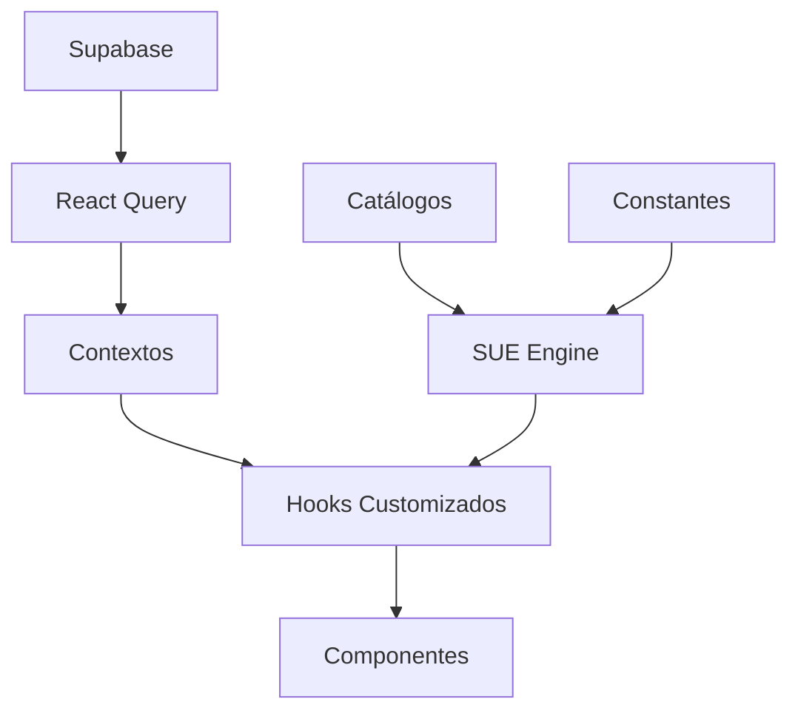

# Arquitetura do Projeto - Ordem Paranormal RPG

> **FASE 5 EM PROGRESSO** - Migrando trilhas para componentes responsivos unificados (1/15 concluídas).

## Visão Geral

Este projeto implementa uma aplicação web para gerenciamento de fichas e campanhas do sistema de RPG **Ordem Paranormal**. A arquitetura é baseada em React + Vite + TypeScript com Tailwind CSS, utilizando Supabase como backend.

---

## Estrutura de Diretórios

```
src/
├── assets/              # Recursos estáticos (imagens, etc.)
├── components/          # Componentes React
│   ├── admin/           # Componentes de administração
│   ├── auth/            # Autenticação (ProtectedRoute, AdminRoute)
│   ├── campaign/        # Gerenciamento de campanhas
│   ├── cards/           # Cards reutilizáveis
│   ├── character/       # Ficha de personagem
│   │   └── mobile/      # Versões mobile dos componentes
│   ├── combat/          # Sistema de combate
│   ├── dice/            # Sistema de dados
│   ├── inventory/       # Sistema de inventário
│   ├── pwa/             # Componentes PWA
│   └── ui/              # Componentes base (shadcn/ui)
├── contexts/            # Contextos React (Auth, ColorTheme)
├── hooks/               # Hooks customizados
│   ├── sue/             # Sistema Unificado de Efeitos
│   ├── combat/          # Hooks de combate
│   ├── character/       # Hooks de personagem
│   ├── inventory/       # Hooks de inventário
│   ├── validation/      # Hooks de validação
│   ├── campaign/        # Hooks de campanha
│   ├── ui/              # Hooks de interface
│   └── platform/        # Hooks de plataforma (PWA)
├── integrations/        # Integrações externas
│   └── supabase/        # Cliente e tipos Supabase
├── lib/                 # Lógica de negócio
│   ├── catalogs/        # Catálogos de equipamentos
│   ├── class-powers/    # Sistema de poderes de classe
│   ├── conditions/      # Sistema de condições
│   ├── constants/       # Constantes do sistema
│   ├── effects/         # Adaptadores SUE
│   ├── general-powers/  # Poderes gerais
│   ├── origins/         # Origens de personagem
│   ├── paranormal-powers/ # Poderes paranormais
│   └── rituals/         # Sistema de rituais
├── pages/               # Páginas da aplicação
└── docs/                # Documentação técnica
```

---

## Módulos Principais

### 1. Sistema Unificado de Efeitos (SUE)

O coração do sistema de regras. Centraliza o cálculo de todos os efeitos, bônus e modificadores.

**Arquivos principais:**
- `src/lib/unified-effects-engine.ts` - Motor principal
- `src/lib/effects/` - Adaptadores por tipo de efeito
- `src/hooks/sue/` - Hooks que consomem o SUE

**Documentação:** [SISTEMA_UNIFICADO_EFEITOS.md](./SISTEMA_UNIFICADO_EFEITOS.md)

### 2. Catálogos (`src/lib/catalogs/`)

Dados estáticos de equipamentos do jogo.

```typescript
import { 
  ALL_WEAPONS, 
  ALL_ARMORS, 
  ALL_ITEMS, 
  CURSED_ITEMS 
} from '@/lib/catalogs';
```

**Arquivos:**
- `weapons-catalog.ts` - Armas (corpo a corpo, distância, fogo)
- `armor-catalog.ts` - Proteções
- `items-catalog.ts` - Itens gerais
- `cursed-items.ts` - Itens amaldiçoados

### 3. Constantes (`src/lib/constants/`)

IDs centralizados do sistema para validação e consistência.

```typescript
import { 
  CLASS_IDS, 
  ALL_TRACK_IDS, 
  ELEMENT_IDS,
  ATTRIBUTE_NAMES 
} from '@/lib/constants';
```

**Arquivos:**
- `game-ids.ts` - IDs de classes, trilhas, origens, patentes, elementos
- `attributes.ts` - Definições de atributos (AGI, FOR, INT, PRE, VIG)

### 4. Poderes de Classe (`src/lib/class-powers/`)

Sistema modular de poderes organizados por classe e trilha.

**Estrutura:**
```
class-powers/
├── index.ts              # Barrel exports
├── types.ts              # Tipos TypeScript
├── power-registry.ts     # Registry de poderes
├── power-effects-engine.ts # Motor de efeitos
├── combatente-powers.ts  # Poderes do Combatente
├── especialista-powers.ts # Poderes do Especialista
├── ocultista-powers.ts   # Poderes do Ocultista
├── track-combatente.ts   # Trilhas do Combatente
├── track-especialista.ts # Trilhas do Especialista
└── track-ocultista.ts    # Trilhas do Ocultista
```

### 5. Condições (`src/lib/conditions/`)

Sistema de condições do jogo com parâmetros e efeitos.

**Estrutura:**
```
conditions/
├── index.ts                # Barrel exports + Registry
└── condition-definitions.ts # Definições de condições
```

**Principais exports:**
```typescript
import { 
  CONDITIONS,
  getConditionById,
  conditionRequiresParams,
  getConditionEffectWithParams,
  getMachucadoDamage,
  getFragilizadoMultiplier,
  canSpendPEWithConditions,
  getMaxActionsFromConditions
} from '@/lib/conditions';
```

### 6. Origens (`src/lib/origins/`)

Origens de personagem incluindo suplementos.

**Estrutura:**
```
origins/
├── index.ts              # Barrel exports + Registry
└── supplement-origins.ts # Origens de suplementos
```

**Principais exports:**
```typescript
import { 
  SUPPLEMENT_ORIGINS,
  ORIGIN_REGISTRY,
  getOriginById,
  getAllOrigins
} from '@/lib/origins';
```

### 7. Poderes Paranormais (`src/lib/paranormal-powers/`)

Poderes por elemento do Outro Lado.

**Estrutura:**
```
paranormal-powers/
├── index.ts              # Barrel exports + Registry
└── power-definitions.ts  # Definições por elemento
```

**Principais exports:**
```typescript
import { 
  PARANORMAL_POWERS_BY_ELEMENT,
  ELEMENT_LABELS,
  ELEMENT_COLORS,
  AFFINITY_DESCRIPTIONS,
  getParanormalPowerById,
  getAllParanormalPowers
} from '@/lib/paranormal-powers';
```

### 8. Poderes Gerais (`src/lib/general-powers/`)

Poderes gerais disponíveis para todas as classes.

**Estrutura:**
```
general-powers/
├── index.ts              # Barrel exports + Registry
└── power-definitions.ts  # Definições de poderes
```

**Principais exports:**
```typescript
import { 
  GENERAL_POWERS,
  POWER_REGISTRY,
  getPowerById,
  getAllPowers
} from '@/lib/general-powers';
```

### 9. Rituais (`src/lib/rituals/`)

Sistema de rituais do 1º ao 4º círculo.

**Estrutura:**
```
rituals/
├── index.ts              # Barrel exports
├── types.ts              # Tipos TypeScript
├── ritual-registry.ts    # Registry de rituais
├── ritual-effects-engine.ts # Motor de efeitos
├── second-circle.ts      # Rituais do 2º círculo
├── third-circle.ts       # Rituais do 3º círculo
└── fourth-circle.ts      # Rituais do 4º círculo
```

### 6. Hooks (`src/hooks/`)

Hooks organizados por domínio funcional.

| Pasta | Descrição |
|-------|-----------|
| `sue/` | Sistema Unificado de Efeitos |
| `combat/` | Gerenciamento de combate |
| `character/` | Dados e validação de personagem |
| `inventory/` | Equipamentos e itens |
| `validation/` | Validação de regras |
| `campaign/` | Sincronização de campanhas |
| `ui/` | Interface (mobile, toast, theme) |
| `platform/` | PWA e funcionalidades de plataforma |

---

## Padrões de Código

### Convenções de Nomenclatura

| Tipo | Padrão | Exemplo |
|------|--------|---------|
| Componentes | PascalCase | `CharacterSheet.tsx` |
| Hooks | camelCase com `use` | `useUnifiedEffects.ts` |
| Constantes | UPPER_SNAKE_CASE | `CLASS_IDS` |
| IDs de jogo | kebab-case | `comandante-campo` |
| Tipos | PascalCase | `CharacterData` |

### Barrel Exports

Cada pasta deve ter um `index.ts` que exporta suas funcionalidades públicas:

```typescript
// src/lib/catalogs/index.ts
export * from './weapons-catalog';
export * from './armor-catalog';
// ...
```

### Componentes Mobile

Componentes mobile ficam em subpastas `mobile/`:

```
character/
├── SkillsGrid.tsx           # Desktop
├── mobile/
│   ├── MobileSkillsTab.tsx  # Mobile
│   └── index.ts             # Exports
```

**Documentação mobile:** [MOBILE_DRAWER.md](./MOBILE_DRAWER.md)

---

## Fluxo de Dados



### Ciclo de Cálculo de Efeitos

1. **Entrada**: Dados do personagem (origem, classe, trilha, poderes, condições)
2. **Adaptadores**: Cada fonte de efeito tem um adaptador em `src/lib/effects/`
3. **Motor SUE**: `unified-effects-engine.ts` processa e combina os efeitos
4. **Hooks**: `useUnifiedEffects` expõe os resultados calculados
5. **Componentes**: Consomem os valores finais via hooks

---

## Banco de Dados

O projeto usa Supabase com as seguintes tabelas principais:

- `characters` - Fichas de personagem
- `campaigns` - Campanhas
- `campaign_members` - Membros de campanhas
- `campaign_sessions` - Sessões de jogo
- `profiles` - Perfis de usuário

**Migrations:** `supabase/migrations/`

---

## Testes

### Organização

```
src/lib/__tests__/           # Testes de lib
src/hooks/__tests__/         # Testes de hooks
src/components/ui/__tests__/ # Testes de UI
```

### Tipos de Teste

- **Unitários**: Funções isoladas
- **Integração**: Hooks com múltiplas dependências
- **Snapshot**: Componentes mobile

### Executar Testes

```bash
npm run test          # Todos os testes
npm run test:ui       # Com interface
npm run test -- -u    # Atualizar snapshots
```

---

## PWA

O projeto é uma Progressive Web App com:

- **Offline**: Service worker com cache
- **Instalação**: Prompt de instalação
- **Push**: Notificações para campanhas

**Componentes:** `src/components/pwa/`  
**Hooks:** `src/hooks/platform/`

---

## Próximos Passos de Arquitetura

1. [x] ~~Consolidar origens em pasta dedicada~~ ✅
2. [x] ~~Mover poderes gerais e paranormais para pastas dedicadas~~ ✅
3. [x] ~~Consolidar condições em pasta dedicada~~ ✅
4. [x] ~~Criar componentes de trilha para Ocultista~~ ✅
5. [x] ~~Remover arquivos legados em src/lib/~~ ✅ (FASE 4)
6. [~] Migrar trilhas para componentes responsivos unificados (1/15)
   - [x] Aniquilador (Combatente) ✅
   - [ ] Guerreiro, Comandante de Campo, Operações Especiais, Tropa de Choque (Combatente)
   - [ ] Atirador de Elite, Infiltrador, Médico de Campo, Negociador, Técnico (Especialista)
   - [ ] Conduíte, Flagelador, Graduado, Intuitivo, Lâmina Paranormal (Ocultista)
7. [ ] Expandir testes de integração do SUE

---

## Referências

- [MOBILE_DRAWER.md](./MOBILE_DRAWER.md) - Componentes mobile
- [SISTEMA_UNIFICADO_EFEITOS.md](./SISTEMA_UNIFICADO_EFEITOS.md) - Motor SUE
- [SUE_TEST_COVERAGE.md](./SUE_TEST_COVERAGE.md) - Cobertura de testes
