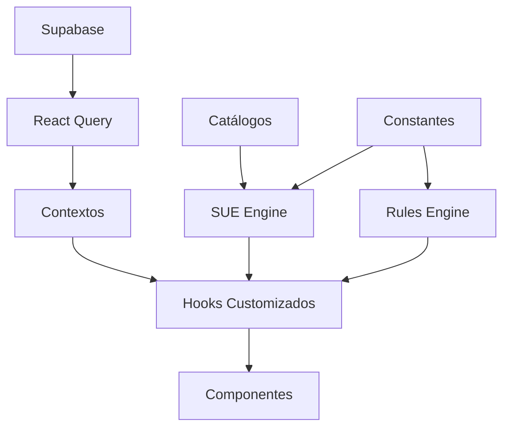

# Arquitetura do Projeto - Ordem Paranormal RPG

> **Última atualização:** 2026-01-26  
> **TODAS AS FASES CONCLUÍDAS** ✅ - Sistema completo com motor de regras, validação automática e ~560 testes.

## Visão Geral

Este projeto implementa uma aplicação web para gerenciamento de fichas e campanhas do sistema de RPG **Ordem Paranormal**. A arquitetura é baseada em React + Vite + TypeScript com Tailwind CSS, utilizando Supabase como backend.

---

## Estrutura de Diretórios

```
src/
├── assets/              # Recursos estáticos (imagens, etc.)
├── components/          # Componentes React
│   ├── admin/           # Componentes de administração
│   ├── auth/            # Autenticação (ProtectedRoute, AdminRoute)
│   ├── campaign/        # Gerenciamento de campanhas
│   │   └── diary/       # Diário de sessões
│   ├── cards/           # Cards reutilizáveis
│   ├── character/       # Ficha de personagem
│   │   ├── mobile/      # Versões mobile dos componentes
│   │   └── tracks/      # Painéis de trilha (15 trilhas)
│   ├── combat/          # Sistema de combate
│   ├── dice/            # Sistema de dados
│   ├── inventory/       # Sistema de inventário
│   ├── pwa/             # Componentes PWA
│   └── ui/              # Componentes base (shadcn/ui)
├── contexts/            # Contextos React (Auth, ColorTheme)
├── hooks/               # Hooks customizados
│   ├── sue/             # Sistema Unificado de Efeitos
│   ├── combat/          # Hooks de combate
│   ├── character/       # Hooks de personagem
│   ├── inventory/       # Hooks de inventário
│   ├── validation/      # Hooks de validação
│   ├── campaign/        # Hooks de campanha
│   ├── ui/              # Hooks de interface
│   └── platform/        # Hooks de plataforma (PWA)
├── integrations/        # Integrações externas
│   └── supabase/        # Cliente e tipos Supabase
├── lib/                 # Lógica de negócio
│   ├── catalogs/        # Catálogos de equipamentos
│   ├── class-powers/    # Sistema de poderes de classe
│   ├── conditions/      # Sistema de condições
│   ├── constants/       # Constantes do sistema
│   ├── effects/         # Adaptadores SUE
│   ├── general-powers/  # Poderes gerais
│   ├── origins/         # Origens de personagem
│   ├── paranormal-powers/ # Poderes paranormais
│   ├── rituals/         # Sistema de rituais
│   ├── rules-engine/    # Motor de regras padronizado
│   └── __tests__/       # Testes unitários (~560 testes)
├── pages/               # Páginas da aplicação
└── docs/                # Documentação técnica
```

---

## Módulos Principais

### 1. Sistema Unificado de Efeitos (SUE)

O coração do sistema de regras. Centraliza o cálculo de todos os efeitos, bônus e modificadores.

**Arquivos principais:**
- `src/lib/unified-effects-engine.ts` - Motor principal
- `src/lib/effects/` - Adaptadores por tipo de efeito
- `src/hooks/sue/` - Hooks que consomem o SUE

**Documentação:** [SISTEMA_UNIFICADO_EFEITOS.md](./SISTEMA_UNIFICADO_EFEITOS.md)

### 2. Motor de Regras Padronizado

Sistema determinístico para cálculos de personagem, validação e rolagens.

**Arquivos principais:**
- `src/lib/rules-engine/derive-character.ts` - Cálculo de estatísticas derivadas
- `src/lib/rules-engine/validate-character.ts` - Validação contra regras oficiais
- `src/lib/rules-engine/apply-and-roll.ts` - Aplicação de efeitos e rolagens

**Funções:**

| Função | Responsabilidade |
|--------|------------------|
| `deriveCharacter` | Calcula PV, PE, SAN, Defesa, resistências com breakdowns |
| `validateCharacter` | Valida pré-requisitos, perícias de origem, trilha |
| `applyEffect` | Aplica modificações ao estado do personagem |
| `rollAction` | Executa rolagens de perícia, ataque, dano |

### 3. Catálogos (`src/lib/catalogs/`)

Dados estáticos de equipamentos do jogo.

```typescript
import { 
  ALL_WEAPONS, 
  ALL_ARMORS, 
  ALL_ITEMS, 
  CURSED_ITEMS 
} from '@/lib/catalogs';
```

**Arquivos:**
- `weapons-catalog.ts` - Armas (corpo a corpo, distância, fogo)
- `armor-catalog.ts` - Proteções
- `items-catalog.ts` - Itens gerais
- `cursed-items.ts` - Itens amaldiçoados

### 4. Constantes (`src/lib/constants/`)

IDs centralizados do sistema para validação e consistência.

```typescript
import { 
  CLASS_IDS, 
  ALL_TRACK_IDS, 
  ELEMENT_IDS,
  ATTRIBUTE_NAMES 
} from '@/lib/constants';
```

**Arquivos:**
- `game-ids.ts` - IDs de classes, trilhas, origens, patentes, elementos
- `attributes.ts` - Definições de atributos (AGI, FOR, INT, PRE, VIG)

### 5. Poderes de Classe (`src/lib/class-powers/`)

Sistema modular de poderes organizados por classe e trilha.

**Estrutura:**
```
class-powers/
├── index.ts              # Barrel exports
├── types.ts              # Tipos TypeScript
├── power-registry.ts     # Registry de poderes
├── power-effects-engine.ts # Motor de efeitos
├── combatente-powers.ts  # Poderes do Combatente
├── especialista-powers.ts # Poderes do Especialista
├── ocultista-powers.ts   # Poderes do Ocultista
├── track-combatente.ts   # Trilhas do Combatente
├── track-especialista.ts # Trilhas do Especialista
└── track-ocultista.ts    # Trilhas do Ocultista
```

### 6. Condições (`src/lib/conditions/`)

Sistema de condições do jogo com parâmetros e efeitos.

**Principais exports:**
```typescript
import { 
  CONDITIONS,
  getConditionById,
  conditionRequiresParams,
  getConditionEffectWithParams,
  getMachucadoDamage,
  getFragilizadoMultiplier,
  canSpendPEWithConditions,
  getMaxActionsFromConditions
} from '@/lib/conditions';
```

### 7. Origens (`src/lib/origins/`)

Origens de personagem incluindo suplementos.

**Principais exports:**
```typescript
import { 
  SUPPLEMENT_ORIGINS,
  ORIGIN_REGISTRY,
  getOriginById,
  getAllOrigins
} from '@/lib/origins';
```

### 8. Rituais (`src/lib/rituals/`)

Sistema de rituais do 1º ao 4º círculo.

**Estrutura:**
```
rituals/
├── index.ts              # Barrel exports
├── types.ts              # Tipos TypeScript
├── unified-rituals.ts    # Catálogo unificado (97 rituais)
├── ritual-casting-engine.ts # Motor de execução
├── second-circle.ts      # Rituais do 2º círculo
├── third-circle.ts       # Rituais do 3º círculo
└── fourth-circle.ts      # Rituais do 4º círculo
```

### 9. Hooks (`src/hooks/`)

Hooks organizados por domínio funcional.

| Pasta | Descrição |
|-------|-----------|
| `sue/` | Sistema Unificado de Efeitos |
| `combat/` | Gerenciamento de combate |
| `character/` | Dados e validação de personagem |
| `inventory/` | Equipamentos e itens |
| `validation/` | Validação de regras |
| `campaign/` | Sincronização de campanhas |
| `ui/` | Interface (mobile, toast, theme) |
| `platform/` | PWA e funcionalidades de plataforma |

---

## Sistema de Validação Automática

### ValidationAutoFixModal

Modal que permite validar e corrigir automaticamente inconsistências em fichas de personagem.

**Localização:** `src/components/character/ValidationAutoFixModal.tsx`

**Funcionalidades:**
- Lista problemas encontrados (erros e avisos)
- Separa correções automáticas de revisões manuais
- Permite selecionar quais correções aplicar
- Aplica correções em batch com persistência no banco

**Hook:** `src/hooks/useValidationAutoFix.ts`

### Validações Implementadas

| Categoria | Validação | Auto-Fix |
|-----------|-----------|----------|
| **Origens** | Perícias concedidas pela origem | ✅ |
| **Origens** | Exceção para Amnésico | ✅ |
| **Trilhas** | Pré-requisitos de perícia | ✅ |
| **Poderes** | Pré-requisitos de NEX | ✅ |
| **Poderes** | Pré-requisitos de atributo | ❌ |
| **Atributos** | Valores dentro dos limites | ✅ |
| **Perícias** | Níveis válidos | ✅ |

---

## Padrões de Código

### Convenções de Nomenclatura

| Tipo | Padrão | Exemplo |
|------|--------|---------|
| Componentes | PascalCase | `CharacterSheet.tsx` |
| Hooks | camelCase com `use` | `useUnifiedEffects.ts` |
| Constantes | UPPER_SNAKE_CASE | `CLASS_IDS` |
| IDs de jogo | kebab-case | `comandante-campo` |
| Tipos | PascalCase | `CharacterData` |

### Barrel Exports

Cada pasta deve ter um `index.ts` que exporta suas funcionalidades públicas:

```typescript
// src/lib/catalogs/index.ts
export * from './weapons-catalog';
export * from './armor-catalog';
// ...
```

### Componentes de Trilha (Responsivos Unificados)

Todas as 15 trilhas usam componentes responsivos que funcionam em desktop e mobile:

```
components/character/tracks/
├── combatente/              # 5 trilhas
│   ├── AniquiladorPanel.tsx
│   ├── GuerreiroAbilitiesPanel.tsx
│   ├── LeadershipAbilitiesPanel.tsx  # Comandante de Campo
│   ├── OperacoesEspeciaisPanel.tsx
│   └── TropaDeChoquePanel.tsx
├── especialista/            # 5 trilhas
│   ├── AtiradorDeElitePanel.tsx
│   ├── InfiltradorPanel.tsx
│   ├── MedicoDeCampoPanel.tsx
│   ├── NegociadorPanel.tsx
│   └── TecnicoPanel.tsx
├── ocultista/               # 5 trilhas
│   ├── ConduitePanel.tsx
│   ├── FlageladorPanel.tsx
│   ├── GraduadoPanel.tsx
│   ├── IntuitivoPanel.tsx
│   └── LaminaParanormalPanel.tsx
└── shared/                  # Componentes compartilhados
    └── UnifiedAbilityItem.tsx
```

Os painéis detectam automaticamente o contexto (mobile/desktop) via `useIsMobile()` e ajustam layout e interações.

---

## Fluxo de Dados



### Ciclo de Cálculo de Efeitos

1. **Entrada**: Dados do personagem (origem, classe, trilha, poderes, condições)
2. **Adaptadores**: Cada fonte de efeito tem um adaptador em `src/lib/effects/`
3. **Motor SUE**: `unified-effects-engine.ts` processa e combina os efeitos
4. **Motor de Regras**: `rules-engine/` calcula derivados e valida
5. **Hooks**: `useUnifiedEffects` expõe os resultados calculados
6. **Componentes**: Consomem os valores finais via hooks

### Ciclo de Validação

1. **Entrada**: Estado do personagem (`CharacterState`)
2. **Validação**: `validateCharacter()` verifica regras
3. **Issues**: Retorna lista de problemas com severidade
4. **Sugestões**: Cada issue pode ter um `suggestedFix`
5. **Modal**: `ValidationAutoFixModal` exibe e permite aplicar fixes
6. **Persistência**: `useValidationAutoFix` salva no banco

---

## Banco de Dados

O projeto usa Supabase com as seguintes tabelas principais:

- `characters` - Fichas de personagem
- `campaigns` - Campanhas
- `campaign_members` - Membros de campanhas
- `campaign_sessions` - Sessões de jogo
- `character_active_conditions` - Condições ativas
- `character_sustained_rituals` - Rituais sustentados
- `profiles` - Perfis de usuário

**Migrations:** `supabase/migrations/`

---

## Testes

### Organização

```
src/lib/__tests__/           # Testes de lib (~560 testes)
src/hooks/__tests__/         # Testes de hooks
src/components/ui/__tests__/ # Testes de UI
```

### Tipos de Teste

- **Unitários**: Funções isoladas
- **Integração**: Hooks com múltiplas dependências
- **E2E**: Fluxos completos de personagem
- **Snapshot**: Componentes mobile

### Executar Testes

```bash
npm run test          # Todos os testes
npm run test:ui       # Com interface
npm run test -- -u    # Atualizar snapshots
```

### Cobertura

| Categoria | Testes |
|-----------|--------|
| **SUE Base** | ~366 |
| **Integração Avançada** | ~120 |
| **Validação** | ~35 |
| **Origens** | ~50 |
| **Trilhas** | ~100 |

---

## PWA

O projeto é uma Progressive Web App com:

- **Offline**: Service worker com cache
- **Instalação**: Prompt de instalação
- **Push**: Notificações para campanhas

**Componentes:** `src/components/pwa/`  
**Hooks:** `src/hooks/platform/`

---

## ✅ Status das Fases de Arquitetura

### Fases Concluídas

| Fase | Descrição | Status |
|------|-----------|--------|
| Arq 1 | Consolidar origens em pasta dedicada | ✅ 100% |
| Arq 2 | Mover poderes gerais e paranormais para pastas dedicadas | ✅ 100% |
| Arq 3 | Organizar hooks por domínio | ✅ 100% |
| Arq 4 | Criar componentes de trilha para Ocultista | ✅ 100% |
| Arq 4b | Remover arquivos legados em src/lib/ | ✅ 100% |
| Arq 5 | Migrar trilhas para componentes responsivos unificados | ✅ 15/15 |
| Arq 6 | Remover arquivos legados desktop/mobile | ✅ 100% |
| Arq 7 | Testes de Integração Avançados do SUE | ✅ +120 testes |

### Fases de Combate - Concluídas

| Fase | Descrição | Status |
|------|-----------|--------|
| Combat 7.5 | Push Notifications para combate | ✅ 100% |
| Combat 7.6 | CombatTracker Mobile otimizado | ✅ 100% |

### Fases de Testes SUE - Concluídas

| Fase | Descrição | Status |
|------|-----------|--------|
| Testes 1-6 | Testes unitários e de integração básicos | ✅ ~366 testes |
| Testes 7 | Testes de integração avançados | ✅ +120 testes |
| **Total** | | **~560 testes** |

### Fases de Condições - Concluídas

| Fase | Descrição | Status |
|------|-----------|--------|
| Cond 8 | Sistema de condições com duração em rodadas | ✅ 100% |
| Cond 8b | Sincronização realtime mestre/jogadores | ✅ 100% |

### Fases de Rituais - Concluídas

| Fase | Descrição | Status |
|------|-----------|--------|
| Rituals 9 | Sistema de Buffs por Turno | ✅ 100% |

### Fases de Campanha - Concluídas

| Fase | Descrição | Status |
|------|-----------|--------|
| Campaign 10 | Sistema de Diário de Sessão | ✅ 100% |

### Fases de Motor de Regras - Concluídas

| Fase | Descrição | Status |
|------|-----------|--------|
| Rules 1 | Motor de Regras Padronizado | ✅ 100% |
| Rules 2 | Validação de Personagem | ✅ 100% |
| Rules 3 | Validação de Perícias de Origem | ✅ 100% |
| Rules 4 | Validação de Pré-requisitos de Trilha | ✅ 100% |
| Rules 5 | Modal de Correção Automática | ✅ 100% |
| Rules 6 | Integração com CharacterSheet | ✅ 100% |

---

## Referências

- [SISTEMA_UNIFICADO_EFEITOS.md](./SISTEMA_UNIFICADO_EFEITOS.md) - Motor SUE
- [SUE_TEST_COVERAGE.md](./SUE_TEST_COVERAGE.md) - Cobertura de testes
- [ORIGENS_MECANICAS_COMPLETAS.md](./ORIGENS_MECANICAS_COMPLETAS.md) - Implementação de origens
- [MOBILE_DRAWER.md](./MOBILE_DRAWER.md) - Padrões de UI mobile
