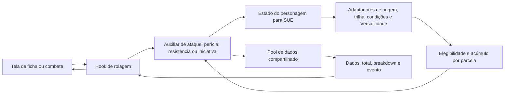

# Ordem Roll — primeiro lote de correções de regras

## 1. Resumo da alteração

Implementado em branch `codex/rules-foundation`, baseada em `4fc25f5e17002b561bdfbc7e44c7e970f15b6c86` de main. Este é um rascunho para revisão, não uma atualização publicada no Lovable.

Correções: pools de ataques/perícias/resistências/iniciativa, conservação de modificadores negativos, separação entre penalidades em dados e valores numéricos, condições compostas sem duplicação e exclusão parcial de bônus numéricos do SUE. Machucado não causa dano ao agir; Vulnerável reduz Defesa; Frustrado não bloqueia PE. Previsão e rolagem de iniciativa usam o mesmo catálogo.

Decisão do usuário: manter a regra personalizada de acerto. Mesmo um 20 selecionado precisa atingir a Defesa; uma margem ampliada de crítico também não garante acerto. Não foi ativada a regra oficial de sucesso automático.

Fontes: Livro Base v1.3, pp. 11, 27, 39–40, 75 e 310–312. Para o caso de atributo negativo sem modificadores em dados, referência ao suplemento final, p. 81. A prévia recebida não foi tratada como equivalente à versão final.

## 2. Arquivos alterados/criados

São 31 arquivos de código, testes e configuração, mais este documento. Arquivos de evidência, livros e extrações não foram incluídos no repositório. As dependências e os consumidores abaixo foram identificados estaticamente; chamadas dinâmicas podem exigir conferência adicional.

### `package-lock.json`

Registra o peer de testes e sincroniza react-helmet-async já declarado anteriormente. Não introduz uma nova biblioteca de produção.

- Utiliza: Sem importação local identificada.
- Consumidores identificados: Execução pelo runner de testes/configuração ou consulta direta.

### `package.json`

Adiciona npm test e declara @testing-library/dom, dependência de desenvolvimento exigida pelo peer de @testing-library/react já usado no projeto.

- Utiliza: Sem importação local identificada.
- Consumidores identificados: Execução pelo runner de testes/configuração ou consulta direta.

### `src/components/character/bonus-breakdown-snapshot.vitest.tsx`

Teste automatizado: atualiza expectativas confrontadas com as fontes ou valida os novos contratos, sem usar personagens reais e sem gravações no Supabase.

- Utiliza: src/components/character/TrackCombatBonusesBar.tsx, src/components/character/__tests__/breakdown-test-utils.ts
- Consumidores identificados: Execução pelo runner de testes/configuração ou consulta direta.

### `src/hooks/__tests__/rules-foundation-context.vitest.ts`

Teste automatizado: atualiza expectativas confrontadas com as fontes ou valida os novos contratos, sem usar personagens reais e sem gravações no Supabase.

- Utiliza: src/hooks/useUnifiedEffects.ts, src/hooks/sue/useSkillRollWithSUE.ts
- Consumidores identificados: Execução pelo runner de testes/configuração ou consulta direta.

### `src/hooks/__tests__/useUnifiedEffects.vitest.ts`

Teste automatizado: atualiza expectativas confrontadas com as fontes ou valida os novos contratos, sem usar personagens reais e sem gravações no Supabase.

- Utiliza: src/hooks/useUnifiedEffects.ts
- Consumidores identificados: Execução pelo runner de testes/configuração ou consulta direta.

### `src/hooks/sue/useInitiativeRollWithSUE.ts`

Adapta iniciativa para a tela e calcula a previsão com o mesmo estado/catálogo da rolagem, incluindo treinamento e Versatilidade.

- Utiliza: src/lib/rules-engine/types.ts, src/lib/rules-engine/index.ts, src/lib/dice-roller.ts, src/lib/rules-engine/sue-bridge.ts
- Consumidores identificados: src/components/character/TrackCombatBonusesBar.tsx, src/hooks/sue/index.ts

### `src/hooks/sue/useResistanceRollWithSUE.ts`

Adapta resistência para a tela, conserva treinamento e critério do pool e aceita perícias opcionais na configuração.

- Utiliza: src/lib/rules-engine/types.ts, src/lib/rules-engine/index.ts, src/lib/dice-roller.ts
- Consumidores identificados: src/components/character/ResistanceCheckModal.tsx, src/hooks/sue/index.ts

### `src/hooks/sue/useSkillRollWithSUE.ts`

Adapta o resultado de perícia ao formato das telas e informa o critério real de pior dado, mesmo com atributo positivo.

- Utiliza: src/lib/rules-engine/types.ts, src/lib/rules-engine/index.ts, src/lib/dice-roller.ts
- Consumidores identificados: src/components/character/mobile/MobileDiceRollModal.tsx, src/components/dice/DiceRollModal.tsx, src/hooks/__tests__/rules-foundation-context.vitest.ts, src/hooks/character/useSkillRoll.ts, src/hooks/sue/index.ts

### `src/hooks/useUnifiedEffects.ts`

Entrega efeitos computados à ficha; filtra elegibilidade no diagnóstico de acúmulo e recalcula quando PV, PE ou contexto de ataque mudam.

- Utiliza: src/lib/unified-effects-engine.ts, src/lib/sue/consolidation-with-hardening.ts, src/lib/sue/effect-application-order.ts, src/lib/sue/stacking-rules.ts, src/lib/effects/origin-effects-adapter.ts, src/lib/effects/track-effects-adapter.ts, src/lib/effects/condition-effects-adapter.ts, src/lib/effects/ritual-effects-adapter.ts, src/lib/effects/paranormal-powers-effects-adapter.ts, src/lib/effects/class-power-effects-adapter.ts, src/lib/effects/conditional-bonus-effects-adapter.ts, src/lib/paranormal-powers/index.ts, src/lib/sue/consolidation-with-hardening.ts, src/lib/sue/stacking-rules.ts, src/lib/sue/effect-application-order.ts
- Consumidores identificados: src/components/character/mobile/MobileSUEDebugPanel.tsx, src/hooks/__tests__/rules-foundation-context.vitest.ts, src/hooks/__tests__/useUnifiedEffects.vitest.ts, src/hooks/sue/index.ts, src/hooks/useBonusSummaryFromSUE.ts, src/hooks/useRitualBonusesFromSUE.ts, src/lib/__tests__/sue-integration.vitest.ts

### `src/lib/__tests__/computed-effects-snapshot.vitest.ts`

Teste automatizado: atualiza expectativas confrontadas com as fontes ou valida os novos contratos, sem usar personagens reais e sem gravações no Supabase.

- Utiliza: src/lib/unified-effects-engine.ts
- Consumidores identificados: Execução pelo runner de testes/configuração ou consulta direta.

### `src/lib/__tests__/conditions.vitest.ts`

Teste automatizado: atualiza expectativas confrontadas com as fontes ou valida os novos contratos, sem usar personagens reais e sem gravações no Supabase.

- Utiliza: src/lib/conditions/index.ts
- Consumidores identificados: Execução pelo runner de testes/configuração ou consulta direta.

### `src/lib/__tests__/rules-foundation.vitest.ts`

Teste automatizado: atualiza expectativas confrontadas com as fontes ou valida os novos contratos, sem usar personagens reais e sem gravações no Supabase.

- Utiliza: src/lib/attribute-dice-pool.ts, src/lib/effects/condition-effects-adapter.ts, src/lib/conditions-data.ts, src/lib/conditions/index.ts, src/lib/conditions/base-condition-rules.ts, src/lib/unified-effects-engine.ts, src/lib/rules-engine/sue-bridge.ts, src/lib/rules-engine/helpers/attack-with-sue.ts, src/lib/rules-engine/helpers/skill-check-with-sue.ts, src/lib/rules-engine/helpers/resistance-check-with-sue.ts, src/lib/rules-engine/helpers/initiative-with-sue.ts, src/lib/rules-engine/types.ts
- Consumidores identificados: Execução pelo runner de testes/configuração ou consulta direta.

### `src/lib/__tests__/sue-edge-cases.vitest.ts`

Teste automatizado: atualiza expectativas confrontadas com as fontes ou valida os novos contratos, sem usar personagens reais e sem gravações no Supabase.

- Utiliza: src/lib/unified-effects-engine.ts
- Consumidores identificados: Execução pelo runner de testes/configuração ou consulta direta.

### `src/lib/__tests__/sue-integration.vitest.ts`

Teste automatizado: atualiza expectativas confrontadas com as fontes ou valida os novos contratos, sem usar personagens reais e sem gravações no Supabase.

- Utiliza: src/hooks/useUnifiedEffects.ts, src/lib/effects/condition-effects-adapter.ts, src/lib/effects/class-power-effects-adapter.ts, src/lib/effects/ritual-effects-adapter.ts, src/lib/unified-effects-engine.ts, src/lib/unified-effects-engine.ts
- Consumidores identificados: Execução pelo runner de testes/configuração ou consulta direta.

### `src/lib/__tests__/sue-stacking-integration.vitest.ts`

Teste automatizado: atualiza expectativas confrontadas com as fontes ou valida os novos contratos, sem usar personagens reais e sem gravações no Supabase.

- Utiliza: src/lib/unified-effects-engine.ts
- Consumidores identificados: Execução pelo runner de testes/configuração ou consulta direta.

### `src/lib/__tests__/sue-stacking-rules.vitest.ts`

Teste automatizado: atualiza expectativas confrontadas com as fontes ou valida os novos contratos, sem usar personagens reais e sem gravações no Supabase.

- Utiliza: src/lib/sue/index.ts
- Consumidores identificados: Execução pelo runner de testes/configuração ou consulta direta.

### `src/lib/attribute-dice-pool.ts`

Valida atributo/penalidade em dados e retorna quantidade, critério de seleção e resultados do pool. Não soma treinamento nem envia dados ao banco.

- Utiliza: Sem importação local identificada.
- Consumidores identificados: src/lib/__tests__/rules-foundation.vitest.ts, src/lib/rules-engine/helpers/attack-with-sue.ts, src/lib/rules-engine/helpers/initiative-with-sue.ts, src/lib/rules-engine/helpers/skill-check-with-sue.ts

### `src/lib/conditions-data.ts`

Mantém o cadastro legado de interface e aplica o texto comum às condições presentes nele.

- Utiliza: src/lib/conditions/base-condition-rules.ts
- Consumidores identificados: src/components/character/conditions/ConditionManager.tsx, src/hooks/character/useConditions.ts, src/hooks/combat/useCombatConditions.ts, src/lib/__tests__/rules-foundation.vitest.ts

### `src/lib/conditions/base-condition-rules.ts`

Centraliza o texto e as mecânicas conferidas deste lote e expande condições compostas apenas em memória, sem duplicar os graus substituídos.

- Utiliza: src/lib/unified-effects-engine.ts
- Consumidores identificados: src/lib/__tests__/rules-foundation.vitest.ts, src/lib/conditions/condition-definitions.ts, src/lib/conditions-data.ts, src/lib/effects/condition-effects-adapter.ts

### `src/lib/conditions/condition-definitions.ts`

Mantém o cadastro da ficha/mobile e auxiliares legados de parâmetros, ações, Defesa e PE; remove efeitos indevidos e conserva assinaturas existentes.

- Utiliza: src/lib/conditions/base-condition-rules.ts
- Consumidores identificados: src/lib/conditions/index.ts

### `src/lib/effects/__tests__/condition-effects-adapter.vitest.ts`

Teste automatizado: atualiza expectativas confrontadas com as fontes ou valida os novos contratos, sem usar personagens reais e sem gravações no Supabase.

- Utiliza: src/lib/effects/condition-effects-adapter.ts, src/lib/conditions/index.ts
- Consumidores identificados: Execução pelo runner de testes/configuração ou consulta direta.

### `src/lib/effects/condition-effects-adapter.ts`

Converte IDs e parâmetros de condições em efeitos do SUE, incluindo condições derivadas. Conserva dados de entrada e separa penalidades em d20 dos valores numéricos.

- Utiliza: src/lib/conditions/base-condition-rules.ts, src/lib/unified-effects-engine.ts, src/lib/conditions/index.ts
- Consumidores identificados: src/hooks/useUnifiedEffects.ts, src/lib/__tests__/combat-integration.vitest.ts, src/lib/__tests__/rules-engine-e2e.vitest.ts, src/lib/__tests__/rules-foundation.vitest.ts, src/lib/__tests__/sue-campaign-scenarios.vitest.ts, src/lib/__tests__/sue-integration-e2e.vitest.ts, src/lib/__tests__/sue-integration.vitest.ts, src/lib/__tests__/sue-multi-character.vitest.ts (mais 4 referências estáticas)

### `src/lib/rules-engine/helpers/attack-with-sue.ts`

Recebe personagem, arma, Defesa e modificadores; retorna ataque, breakdown e evento. Usa pool comum, conserva valores negativos e mantém a regra da casa para acerto.

- Utiliza: src/lib/rules-engine/types.ts, src/lib/rules-engine/sue-bridge.ts, src/lib/attribute-dice-pool.ts, src/lib/rules-engine/sue-bridge.ts
- Consumidores identificados: src/lib/__tests__/roll-with-sue-integration.vitest.ts, src/lib/__tests__/rules-foundation.vitest.ts, src/lib/rules-engine/apply-and-roll.ts

### `src/lib/rules-engine/helpers/initiative-with-sue.ts`

Recebe personagem e modificadores; usa Agilidade como pool e treinamento como bônus numérico. Consulta o catálogo para os bônus de trilha, em vez da progressão divergente por NEX.

- Utiliza: src/lib/rules-engine/types.ts, src/lib/rules-engine/sue-bridge.ts, src/lib/attribute-dice-pool.ts
- Consumidores identificados: src/lib/__tests__/roll-with-sue-integration.vitest.ts, src/lib/__tests__/rules-foundation.vitest.ts, src/lib/rules-engine/apply-and-roll.ts

### `src/lib/rules-engine/helpers/resistance-check-with-sue.ts`

Delega Fortitude, Reflexos e Vontade ao cálculo de perícias, preservando o contrato de resultado de resistência e seu tipo de evento.

- Utiliza: src/lib/rules-engine/types.ts, src/lib/rules-engine/helpers/skill-check-with-sue.ts
- Consumidores identificados: src/lib/__tests__/roll-with-sue-integration.vitest.ts, src/lib/__tests__/rules-foundation.vitest.ts, src/lib/rules-engine/apply-and-roll.ts

### `src/lib/rules-engine/helpers/skill-check-with-sue.ts`

Recebe personagem, perícia, atributo opcional, DT e modificadores; retorna teste, dados e breakdown cuja soma corresponde ao total. Inclui bônus específicos de resistências e iniciativa.

- Utiliza: src/lib/rules-engine/types.ts, src/lib/rules-engine/sue-bridge.ts, src/lib/attribute-dice-pool.ts, src/lib/rules-engine/sue-bridge.ts
- Consumidores identificados: src/lib/__tests__/roll-with-sue-integration.vitest.ts, src/lib/__tests__/rules-foundation.vitest.ts, src/lib/rules-engine/apply-and-roll.ts, src/lib/rules-engine/helpers/resistance-check-with-sue.ts

### `src/lib/rules-engine/sue-bridge.ts`

Converte o estado do personagem para o SUE, preserva parâmetros de condições, inclui Versatilidade disponível e expõe penalidades em dados aos auxiliares de rolagem.

- Utiliza: src/lib/rules-engine/types.ts, src/lib/unified-effects-engine.ts, src/lib/unified-effects-engine.ts, src/lib/effects/origin-effects-adapter.ts, src/lib/effects/condition-effects-adapter.ts, src/lib/effects/track-effects-adapter.ts
- Consumidores identificados: src/hooks/sue/useInitiativeRollWithSUE.ts, src/lib/__tests__/rules-foundation.vitest.ts, src/lib/rules-engine/apply-and-roll.ts, src/lib/rules-engine/derive-character.ts, src/lib/rules-engine/helpers/attack-with-sue.ts, src/lib/rules-engine/helpers/defense-calculation.ts, src/lib/rules-engine/helpers/equipment-validation.ts, src/lib/rules-engine/helpers/initiative-with-sue.ts (mais 8 referências estáticas)

### `src/lib/rules-engine/types.ts`

Adiciona campos opcionais para o critério real de seleção de dados e informação de Versatilidade, mantendo compatibilidade com consumidores anteriores.

- Utiliza: Sem importação local identificada.
- Consumidores identificados: src/components/character/ResistanceCheckModal.tsx, src/components/character/ValidationAutoFixModal.tsx, src/hooks/sue/useInitiativeRollWithSUE.ts, src/hooks/sue/useResistanceRollWithSUE.ts, src/hooks/sue/useRitualDamageWithSUE.ts, src/hooks/sue/useSkillRollWithSUE.ts, src/hooks/use-combat-roll-with-sue.ts, src/hooks/useValidationAutoFix.ts (mais 25 referências estáticas)

### `src/lib/sue/consolidation-with-hardening.ts`

Rastreia parcelas dos efeitos, trata IDs de instância repetidos e remove somente as mecânicas numéricas excluídas, preservando flags e outras parcelas.

- Utiliza: src/lib/unified-effects-engine.ts, src/lib/sue/effect-application-order.ts, src/lib/sue/stacking-rules.ts
- Consumidores identificados: src/hooks/useUnifiedEffects.ts, src/lib/sue/index.ts, src/lib/unified-effects-engine.ts

### `src/lib/sue/stacking-rules.ts`

Agrupa modificadores numéricos por fonte, característica e sinal, escolhendo bônus/penalidades prevalentes e evitando duplicação da mesma habilidade.

- Utiliza: src/lib/unified-effects-engine.ts
- Consumidores identificados: src/hooks/useUnifiedEffects.ts, src/lib/__tests__/rules-engine-e2e.vitest.ts, src/lib/sue/consolidation-with-hardening.ts, src/lib/sue/index.ts

### `src/lib/unified-effects-engine.ts`

Consolida efeitos elegíveis, calcula resultados numéricos e modificadores em dados e retorna breakdowns e flags. Exclui parcelas de bônus antes da soma.

- Utiliza: src/lib/sue/consolidation-with-hardening.ts
- Consumidores identificados: src/components/character/CombatRollModal.tsx, src/components/character/CombatWeaponsTable.tsx, src/components/character/mobile/MobileCombatRollModal.tsx, src/components/character/mobile/MobileTrackPassiveEffectsWidget.tsx, src/components/character/StackingExclusionIndicator.tsx, src/components/character/TrackPassiveEffectsWidget.tsx, src/components/character/tracks/combatente/AniquiladorPanel.tsx, src/hooks/__tests__/integration-track-sue-combat.vitest.ts (mais 41 referências estáticas)

## 3. Fluxo de comunicação



Entradas: atributos, treinamentos, IDs e parâmetros de condições, arma, DT/Defesa, modificadores manuais e dados de trilha/Versatilidade. Saídas: resultados em memória, dados lançados/selecionados, fontes de bônus, flags e eventos para consumidores existentes. Este lote não adiciona endpoints, headers, payloads de rede, tabelas, colunas, migrations nem gravações novas. Os fluxos existentes de salvamento continuam sob responsabilidade dos consumidores.

## 4. Código ou patch

O patch completo acompanha a entrega. Exemplo do contrato central:

```ts
getAttributeDicePool(2);    // 2d20, mantém maior
getAttributeDicePool(0);    // 2d20, mantém menor
getAttributeDicePool(-2);   // 4d20, mantém menor
getAttributeDicePool(2, 2); // penalidade de 2d20: 4d20, mantém menor
```

O atributo determina o pool, não é somado ao resultado. O total corresponde ao dado selecionado + treinamento + bônus/penalidades numéricos + modificador manual. Valores inválidos não inteiros ou não finitos são rejeitados pelo contrato.

## 5. Observações importantes

- Nenhuma ficha real foi aberta para validação, e nenhum dado real, política de acesso ou migration foi alterado.
- IDs e parâmetros persistidos são preservados. Parâmetros legados de Machucado deixam de gerar dano; não são apagados do banco.
- O cadastro legado permanece compatível. A fonte comum cobre as condições deste lote; não é homologação integral de todas as 38 condições e de todo o catálogo.
- O acúmulo corrigido cobre parcelas numéricas rastreadas, com agrupamento por categoria/subtipo e sinal. Combinações entre bônus gerais e específicos, dados extras, estruturas avançadas, redução de custo e atributo aplicado duas vezes exigem contratos adicionais.
- A ponte de rolagem ainda não coleta todas as fontes de poderes, rituais e equipamentos. Isso precisa de um lote de integração próprio; não afirmar que toda a ficha e todos os bônus já estão unificados.
- Empilhamento/persistência de venenos, duração por cena, evolução de condições em novas aplicações, contadores de Morrendo/Enlouquecendo e eventos de dano periódico no celular permanecem pendentes. Caído tem descrição de deslocamento 1,5m; a aplicação desse limite ao deslocamento efetivo ainda precisa de integração específica.
- Combinações de atributo zero/negativo com bônus e penalidades simultâneos em quantidade de dados precisam de homologação editorial. Este lote não adiciona bônus positivos ao pool compartilhado; a implementação de penalidades nesse contexto deve ser revista no perfil de regras antes de publicação.
- Rituais, campanhas, privacidade e UAT autenticada permanecem nos lotes seguintes.
- `@testing-library/dom` é um peer de testes já necessário ao projeto. A sincronização do lock também registra `react-helmet-async`, que já constava no manifesto. A instalação padrão continua encontrando o conflito legado de peers React 19/next-themes 0.3; não foi feita uma atualização de stack neste lote.
- O Ralph Loop instalado usa um stop hook do Claude Code, indisponível nesta sessão do Codex. A execução adotou ciclos explícitos de correção, teste, comparação e revisão; não houve ativação do loop automático nem participação de outro especialista/plugin não acessível.

## 6. Como testar

Resultados finais desta execução:

| Verificação | Resultado |
|---|---|
| Suíte antes das alterações | 2338 aprovados / 2481 testes; 143 falhas |
| Suíte após as alterações | 2395 aprovados / 2536 testes; 141 falhas |
| Novos cenários | 55/55 aprovados |
| Novas falhas contra a baseline | 0 |
| TypeScript da aplicação | aprovado |
| Compilação e PWA | aprovadas |
| Lint direcionado dos módulos centrais | 0 erros; 1 aviso preexistente de dependências de hook |
| Integridade do patch | aprovada |

As 141 falhas restantes coincidem com falhas anteriores. Nenhum teste foi removido ou marcado como ignorado. Expectativas que codificavam regras incorretas foram atualizadas contra as fontes; a verificação de tela da iniciativa passou a conferir explicitamente o bônus +5, em lugar de conservar um snapshot gerado com +8.

Com dependências instaladas, executar:

```powershell
npm test -- src/lib/__tests__/rules-foundation.vitest.ts src/hooks/__tests__/rules-foundation-context.vitest.ts
npm test
node node_modules/typescript/bin/tsc --noEmit -p tsconfig.app.json
npm run build
```

O comando geral `npm test` ainda encerra com falha pelos testes preexistentes. Para validar instalação sem atualizar a stack, o lock foi resolvido localmente com `npm install --package-lock-only --ignore-scripts --offline --legacy-peer-deps`; isso não prova instalação limpa em outro ambiente nem compatibilidade de todos os peers.

UAT pendente em ambiente de teste: comparar computador/celular com personagem sintético; conferir Força 2, atributo zero, Fraco, Caído, Desprevenido, Machucado, Vulnerável e Surdo; conferir iniciativa de Operações Especiais por ID e nome e via Versatilidade; garantir que 20 selecionado ainda possa errar Defesa alta; confirmar que duração, eventos periódicos e salvamento não sejam confundidos com o resultado calculado em memória.
