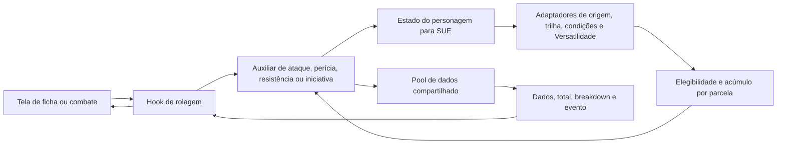

# Ordem Roll — primeiro lote de correções de regras

## 1. Resumo da alteração

Implementado em branch `codex/rules-foundation`, baseada em `4fc25f5e17002b561bdfbc7e44c7e970f15b6c86` de main. Este é um rascunho para revisão, não uma atualização publicada no Lovable.

Correções: pools de ataques/perícias/resistências/iniciativa, conservação de modificadores negativos, separação entre penalidades em dados e valores numéricos, condições compostas sem duplicação e exclusão parcial de bônus numéricos do SUE. Machucado não causa dano ao agir; Vulnerável reduz Defesa; Frustrado não bloqueia PE. Previsão e rolagem de iniciativa usam o mesmo catálogo.

Decisão do usuário: manter a regra personalizada de acerto. Mesmo um 20 selecionado precisa atingir a Defesa; uma margem ampliada de crítico também não garante acerto. Não foi ativada a regra oficial de sucesso automático.

Fontes: Livro Base v1.3, pp. 11, 27, 39–40, 75 e 310–312. Para o caso de atributo negativo sem modificadores em dados, referência ao suplemento final, p. 81. A prévia recebida não foi tratada como equivalente à versão final.

## 2. Arquivos alterados/criados

São 44 arquivos de código, testes e configuração, mais este documento após a validação local das telas. Arquivos de evidência, livros e extrações não foram incluídos no repositório. As dependências e os consumidores abaixo foram identificados estaticamente; chamadas dinâmicas podem exigir conferência adicional.

### `package-lock.json`

Registra o peer de testes e sincroniza react-helmet-async já declarado anteriormente. Não introduz uma nova biblioteca de produção.

- Utiliza: Sem importação local identificada.
- Consumidores identificados: Execução pelo runner de testes/configuração ou consulta direta.

### `package.json`

Adiciona npm test e declara @testing-library/dom, dependência de desenvolvimento exigida pelo peer de @testing-library/react já usado no projeto.

- Utiliza: Sem importação local identificada.
- Consumidores identificados: Execução pelo runner de testes/configuração ou consulta direta.

### `src/components/character/bonus-breakdown-snapshot.vitest.tsx`

Teste automatizado: atualiza expectativas confrontadas com as fontes ou valida os novos contratos, sem usar personagens reais e sem gravações no Supabase.

- Utiliza: src/components/character/TrackCombatBonusesBar.tsx, src/components/character/__tests__/breakdown-test-utils.ts
- Consumidores identificados: Execução pelo runner de testes/configuração ou consulta direta.

### `src/hooks/__tests__/rules-foundation-context.vitest.ts`

Teste automatizado: atualiza expectativas confrontadas com as fontes ou valida os novos contratos, sem usar personagens reais e sem gravações no Supabase.

- Utiliza: src/hooks/useUnifiedEffects.ts, src/hooks/sue/useSkillRollWithSUE.ts
- Consumidores identificados: Execução pelo runner de testes/configuração ou consulta direta.

### `src/hooks/__tests__/useUnifiedEffects.vitest.ts`

Teste automatizado: atualiza expectativas confrontadas com as fontes ou valida os novos contratos, sem usar personagens reais e sem gravações no Supabase.

- Utiliza: src/hooks/useUnifiedEffects.ts
- Consumidores identificados: Execução pelo runner de testes/configuração ou consulta direta.

### `src/hooks/sue/useInitiativeRollWithSUE.ts`

Adapta iniciativa para a tela e calcula a previsão com o mesmo estado/catálogo da rolagem, incluindo treinamento e Versatilidade.

- Utiliza: src/lib/rules-engine/types.ts, src/lib/rules-engine/index.ts, src/lib/dice-roller.ts, src/lib/rules-engine/sue-bridge.ts
- Consumidores identificados: src/components/character/TrackCombatBonusesBar.tsx, src/hooks/sue/index.ts

### `src/hooks/sue/useResistanceRollWithSUE.ts`

Adapta resistência para a tela, conserva treinamento e critério do pool e aceita perícias opcionais na configuração.

- Utiliza: src/lib/rules-engine/types.ts, src/lib/rules-engine/index.ts, src/lib/dice-roller.ts
- Consumidores identificados: src/components/character/ResistanceCheckModal.tsx, src/hooks/sue/index.ts

### `src/hooks/sue/useSkillRollWithSUE.ts`

Adapta o resultado de perícia ao formato das telas e informa o critério real de pior dado, mesmo com atributo positivo.

- Utiliza: src/lib/rules-engine/types.ts, src/lib/rules-engine/index.ts, src/lib/dice-roller.ts
- Consumidores identificados: src/components/character/mobile/MobileDiceRollModal.tsx, src/components/dice/DiceRollModal.tsx, src/hooks/__tests__/rules-foundation-context.vitest.ts, src/hooks/character/useSkillRoll.ts, src/hooks/sue/index.ts

### `src/hooks/useUnifiedEffects.ts`

Entrega efeitos computados à ficha; filtra elegibilidade no diagnóstico de acúmulo e recalcula quando PV, PE ou contexto de ataque mudam.

- Utiliza: src/lib/unified-effects-engine.ts, src/lib/sue/consolidation-with-hardening.ts, src/lib/sue/effect-application-order.ts, src/lib/sue/stacking-rules.ts, src/lib/effects/origin-effects-adapter.ts, src/lib/effects/track-effects-adapter.ts, src/lib/effects/condition-effects-adapter.ts, src/lib/effects/ritual-effects-adapter.ts, src/lib/effects/paranormal-powers-effects-adapter.ts, src/lib/effects/class-power-effects-adapter.ts, src/lib/effects/conditional-bonus-effects-adapter.ts, src/lib/paranormal-powers/index.ts, src/lib/sue/consolidation-with-hardening.ts, src/lib/sue/stacking-rules.ts, src/lib/sue/effect-application-order.ts
- Consumidores identificados: src/components/character/mobile/MobileSUEDebugPanel.tsx, src/hooks/__tests__/rules-foundation-context.vitest.ts, src/hooks/__tests__/useUnifiedEffects.vitest.ts, src/hooks/sue/index.ts, src/hooks/useBonusSummaryFromSUE.ts, src/hooks/useRitualBonusesFromSUE.ts, src/lib/__tests__/sue-integration.vitest.ts

### `src/lib/__tests__/computed-effects-snapshot.vitest.ts`

Teste automatizado: atualiza expectativas confrontadas com as fontes ou valida os novos contratos, sem usar personagens reais e sem gravações no Supabase.

- Utiliza: src/lib/unified-effects-engine.ts
- Consumidores identificados: Execução pelo runner de testes/configuração ou consulta direta.

### `src/lib/__tests__/conditions.vitest.ts`

Teste automatizado: atualiza expectativas confrontadas com as fontes ou valida os novos contratos, sem usar personagens reais e sem gravações no Supabase.

- Utiliza: src/lib/conditions/index.ts
- Consumidores identificados: Execução pelo runner de testes/configuração ou consulta direta.

### `src/lib/__tests__/rules-foundation.vitest.ts`

Teste automatizado: atualiza expectativas confrontadas com as fontes ou valida os novos contratos, sem usar personagens reais e sem gravações no Supabase.

- Utiliza: src/lib/attribute-dice-pool.ts, src/lib/effects/condition-effects-adapter.ts, src/lib/conditions-data.ts, src/lib/conditions/index.ts, src/lib/conditions/base-condition-rules.ts, src/lib/unified-effects-engine.ts, src/lib/rules-engine/sue-bridge.ts, src/lib/rules-engine/helpers/attack-with-sue.ts, src/lib/rules-engine/helpers/skill-check-with-sue.ts, src/lib/rules-engine/helpers/resistance-check-with-sue.ts, src/lib/rules-engine/helpers/initiative-with-sue.ts, src/lib/rules-engine/types.ts
- Consumidores identificados: Execução pelo runner de testes/configuração ou consulta direta.

### `src/lib/__tests__/sue-edge-cases.vitest.ts`

Teste automatizado: atualiza expectativas confrontadas com as fontes ou valida os novos contratos, sem usar personagens reais e sem gravações no Supabase.

- Utiliza: src/lib/unified-effects-engine.ts
- Consumidores identificados: Execução pelo runner de testes/configuração ou consulta direta.

### `src/lib/__tests__/sue-integration.vitest.ts`

Teste automatizado: atualiza expectativas confrontadas com as fontes ou valida os novos contratos, sem usar personagens reais e sem gravações no Supabase.

- Utiliza: src/hooks/useUnifiedEffects.ts, src/lib/effects/condition-effects-adapter.ts, src/lib/effects/class-power-effects-adapter.ts, src/lib/effects/ritual-effects-adapter.ts, src/lib/unified-effects-engine.ts, src/lib/unified-effects-engine.ts
- Consumidores identificados: Execução pelo runner de testes/configuração ou consulta direta.

### `src/lib/__tests__/sue-stacking-integration.vitest.ts`

Teste automatizado: atualiza expectativas confrontadas com as fontes ou valida os novos contratos, sem usar personagens reais e sem gravações no Supabase.

- Utiliza: src/lib/unified-effects-engine.ts
- Consumidores identificados: Execução pelo runner de testes/configuração ou consulta direta.

### `src/lib/__tests__/sue-stacking-rules.vitest.ts`

Teste automatizado: atualiza expectativas confrontadas com as fontes ou valida os novos contratos, sem usar personagens reais e sem gravações no Supabase.

- Utiliza: src/lib/sue/index.ts
- Consumidores identificados: Execução pelo runner de testes/configuração ou consulta direta.

### `src/lib/attribute-dice-pool.ts`

Valida atributo/penalidade em dados e retorna quantidade, critério de seleção e resultados do pool. Não soma treinamento nem envia dados ao banco.

- Utiliza: Sem importação local identificada.
- Consumidores identificados: src/lib/__tests__/rules-foundation.vitest.ts, src/lib/rules-engine/helpers/attack-with-sue.ts, src/lib/rules-engine/helpers/initiative-with-sue.ts, src/lib/rules-engine/helpers/skill-check-with-sue.ts

### `src/lib/conditions-data.ts`

Mantém o cadastro legado de interface e aplica o texto comum às condições presentes nele.

- Utiliza: src/lib/conditions/base-condition-rules.ts
- Consumidores identificados: src/components/character/conditions/ConditionManager.tsx, src/hooks/character/useConditions.ts, src/hooks/combat/useCombatConditions.ts, src/lib/__tests__/rules-foundation.vitest.ts

### `src/lib/conditions/base-condition-rules.ts`

Centraliza o texto e as mecânicas conferidas deste lote e expande condições compostas apenas em memória, sem duplicar os graus substituídos.

- Utiliza: src/lib/unified-effects-engine.ts
- Consumidores identificados: src/lib/__tests__/rules-foundation.vitest.ts, src/lib/conditions/condition-definitions.ts, src/lib/conditions-data.ts, src/lib/effects/condition-effects-adapter.ts

### `src/lib/conditions/condition-definitions.ts`

Mantém o cadastro da ficha/mobile e auxiliares legados de parâmetros, ações, Defesa e PE; remove efeitos indevidos e conserva assinaturas existentes.

- Utiliza: src/lib/conditions/base-condition-rules.ts
- Consumidores identificados: src/lib/conditions/index.ts

### `src/lib/effects/__tests__/condition-effects-adapter.vitest.ts`

Teste automatizado: atualiza expectativas confrontadas com as fontes ou valida os novos contratos, sem usar personagens reais e sem gravações no Supabase.

- Utiliza: src/lib/effects/condition-effects-adapter.ts, src/lib/conditions/index.ts
- Consumidores identificados: Execução pelo runner de testes/configuração ou consulta direta.

### `src/lib/effects/condition-effects-adapter.ts`

Converte IDs e parâmetros de condições em efeitos do SUE, incluindo condições derivadas. Conserva dados de entrada e separa penalidades em d20 dos valores numéricos.

- Utiliza: src/lib/conditions/base-condition-rules.ts, src/lib/unified-effects-engine.ts, src/lib/conditions/index.ts
- Consumidores identificados: src/hooks/useUnifiedEffects.ts, src/lib/__tests__/combat-integration.vitest.ts, src/lib/__tests__/rules-engine-e2e.vitest.ts, src/lib/__tests__/rules-foundation.vitest.ts, src/lib/__tests__/sue-campaign-scenarios.vitest.ts, src/lib/__tests__/sue-integration-e2e.vitest.ts, src/lib/__tests__/sue-integration.vitest.ts, src/lib/__tests__/sue-multi-character.vitest.ts (mais 4 referências estáticas)

### `src/lib/rules-engine/helpers/attack-with-sue.ts`

Recebe personagem, arma, Defesa e modificadores; retorna ataque, breakdown e evento. Usa pool comum, conserva valores negativos e mantém a regra da casa para acerto.

- Utiliza: src/lib/rules-engine/types.ts, src/lib/rules-engine/sue-bridge.ts, src/lib/attribute-dice-pool.ts, src/lib/rules-engine/sue-bridge.ts
- Consumidores identificados: src/lib/__tests__/roll-with-sue-integration.vitest.ts, src/lib/__tests__/rules-foundation.vitest.ts, src/lib/rules-engine/apply-and-roll.ts

### `src/lib/rules-engine/helpers/initiative-with-sue.ts`

Recebe personagem e modificadores; usa Agilidade como pool e treinamento como bônus numérico. Consulta o catálogo para os bônus de trilha, em vez da progressão divergente por NEX.

- Utiliza: src/lib/rules-engine/types.ts, src/lib/rules-engine/sue-bridge.ts, src/lib/attribute-dice-pool.ts
- Consumidores identificados: src/lib/__tests__/roll-with-sue-integration.vitest.ts, src/lib/__tests__/rules-foundation.vitest.ts, src/lib/rules-engine/apply-and-roll.ts

### `src/lib/rules-engine/helpers/resistance-check-with-sue.ts`

Delega Fortitude, Reflexos e Vontade ao cálculo de perícias, preservando o contrato de resultado de resistência e seu tipo de evento.

- Utiliza: src/lib/rules-engine/types.ts, src/lib/rules-engine/helpers/skill-check-with-sue.ts
- Consumidores identificados: src/lib/__tests__/roll-with-sue-integration.vitest.ts, src/lib/__tests__/rules-foundation.vitest.ts, src/lib/rules-engine/apply-and-roll.ts

### `src/lib/rules-engine/helpers/skill-check-with-sue.ts`

Recebe personagem, perícia, atributo opcional, DT e modificadores; retorna teste, dados e breakdown cuja soma corresponde ao total. Inclui bônus específicos de resistências e iniciativa.

- Utiliza: src/lib/rules-engine/types.ts, src/lib/rules-engine/sue-bridge.ts, src/lib/attribute-dice-pool.ts, src/lib/rules-engine/sue-bridge.ts
- Consumidores identificados: src/lib/__tests__/roll-with-sue-integration.vitest.ts, src/lib/__tests__/rules-foundation.vitest.ts, src/lib/rules-engine/apply-and-roll.ts, src/lib/rules-engine/helpers/resistance-check-with-sue.ts

### `src/lib/rules-engine/sue-bridge.ts`

Converte o estado do personagem para o SUE, preserva parâmetros de condições, inclui Versatilidade disponível e expõe penalidades em dados aos auxiliares de rolagem.

- Utiliza: src/lib/rules-engine/types.ts, src/lib/unified-effects-engine.ts, src/lib/unified-effects-engine.ts, src/lib/effects/origin-effects-adapter.ts, src/lib/effects/condition-effects-adapter.ts, src/lib/effects/track-effects-adapter.ts
- Consumidores identificados: src/hooks/sue/useInitiativeRollWithSUE.ts, src/lib/__tests__/rules-foundation.vitest.ts, src/lib/rules-engine/apply-and-roll.ts, src/lib/rules-engine/derive-character.ts, src/lib/rules-engine/helpers/attack-with-sue.ts, src/lib/rules-engine/helpers/defense-calculation.ts, src/lib/rules-engine/helpers/equipment-validation.ts, src/lib/rules-engine/helpers/initiative-with-sue.ts (mais 8 referências estáticas)

### `src/lib/rules-engine/types.ts`

Adiciona campos opcionais para o critério real de seleção de dados e informação de Versatilidade, mantendo compatibilidade com consumidores anteriores.

- Utiliza: Sem importação local identificada.
- Consumidores identificados: src/components/character/ResistanceCheckModal.tsx, src/components/character/ValidationAutoFixModal.tsx, src/hooks/sue/useInitiativeRollWithSUE.ts, src/hooks/sue/useResistanceRollWithSUE.ts, src/hooks/sue/useRitualDamageWithSUE.ts, src/hooks/sue/useSkillRollWithSUE.ts, src/hooks/use-combat-roll-with-sue.ts, src/hooks/useValidationAutoFix.ts (mais 25 referências estáticas)

### `src/lib/sue/consolidation-with-hardening.ts`

Rastreia parcelas dos efeitos, trata IDs de instância repetidos e remove somente as mecânicas numéricas excluídas, preservando flags e outras parcelas.

- Utiliza: src/lib/unified-effects-engine.ts, src/lib/sue/effect-application-order.ts, src/lib/sue/stacking-rules.ts
- Consumidores identificados: src/hooks/useUnifiedEffects.ts, src/lib/sue/index.ts, src/lib/unified-effects-engine.ts

### `src/lib/sue/stacking-rules.ts`

Agrupa modificadores numéricos por fonte, característica e sinal, escolhendo bônus/penalidades prevalentes e evitando duplicação da mesma habilidade.

- Utiliza: src/lib/unified-effects-engine.ts
- Consumidores identificados: src/hooks/useUnifiedEffects.ts, src/lib/__tests__/rules-engine-e2e.vitest.ts, src/lib/sue/consolidation-with-hardening.ts, src/lib/sue/index.ts

### `src/lib/unified-effects-engine.ts`

Consolida efeitos elegíveis, calcula resultados numéricos e modificadores em dados e retorna breakdowns e flags. Exclui parcelas de bônus antes da soma.

- Utiliza: src/lib/sue/consolidation-with-hardening.ts
- Consumidores identificados: src/components/character/CombatRollModal.tsx, src/components/character/CombatWeaponsTable.tsx, src/components/character/mobile/MobileCombatRollModal.tsx, src/components/character/mobile/MobileTrackPassiveEffectsWidget.tsx, src/components/character/StackingExclusionIndicator.tsx, src/components/character/TrackPassiveEffectsWidget.tsx, src/components/character/tracks/combatente/AniquiladorPanel.tsx, src/hooks/__tests__/integration-track-sue-combat.vitest.ts (mais 41 referências estáticas)

## 3. Fluxo de comunicação



Entradas: atributos, treinamentos, IDs e parâmetros de condições, arma, DT/Defesa, modificadores manuais e dados de trilha/Versatilidade. Saídas: resultados em memória, dados lançados/selecionados, fontes de bônus, flags e eventos para consumidores existentes. Este lote não adiciona endpoints, headers, payloads de rede, tabelas, colunas, migrations nem gravações novas. Os fluxos existentes de salvamento continuam sob responsabilidade dos consumidores.

## 4. Código ou patch

O patch completo acompanha a entrega. Exemplo do contrato central:

```ts
getAttributeDicePool(2);    // 2d20, mantém maior
getAttributeDicePool(0);    // 2d20, mantém menor
getAttributeDicePool(-2);   // 4d20, mantém menor
getAttributeDicePool(2, 2); // penalidade de 2d20: 4d20, mantém menor
```

O atributo determina o pool, não é somado ao resultado. O total corresponde ao dado selecionado + treinamento + bônus/penalidades numéricos + modificador manual. Valores inválidos não inteiros ou não finitos são rejeitados pelo contrato.

## 5. Observações importantes

- Nenhuma ficha real foi aberta para validação, e nenhum dado real, política de acesso ou migration foi alterado.
- IDs e parâmetros persistidos são preservados. Parâmetros legados de Machucado deixam de gerar dano; não são apagados do banco.
- O cadastro legado permanece compatível. A fonte comum cobre as condições deste lote; não é homologação integral de todas as 38 condições e de todo o catálogo.
- O acúmulo corrigido cobre parcelas numéricas rastreadas, com agrupamento por categoria/subtipo e sinal. Combinações entre bônus gerais e específicos, dados extras, estruturas avançadas, redução de custo e atributo aplicado duas vezes exigem contratos adicionais.
- A ponte de rolagem ainda não coleta todas as fontes de poderes, rituais e equipamentos. Isso precisa de um lote de integração próprio; não afirmar que toda a ficha e todos os bônus já estão unificados.
- Empilhamento/persistência de venenos, duração por cena, evolução de condições em novas aplicações, contadores de Morrendo/Enlouquecendo e eventos de dano periódico no celular permanecem pendentes. Caído tem descrição de deslocamento 1,5m; a aplicação desse limite ao deslocamento efetivo ainda precisa de integração específica.
- Combinações de atributo zero/negativo com bônus e penalidades simultâneos em quantidade de dados precisam de homologação editorial. Este lote não adiciona bônus positivos ao pool compartilhado; a implementação de penalidades nesse contexto deve ser revista no perfil de regras antes de publicação.
- Rituais, campanhas, privacidade e UAT autenticada permanecem nos lotes seguintes.
- `@testing-library/dom` é um peer de testes já necessário ao projeto. A sincronização do lock também registra `react-helmet-async`, que já constava no manifesto. A instalação padrão continua encontrando o conflito legado de peers React 19/next-themes 0.3; não foi feita uma atualização de stack neste lote.
- O Ralph Loop instalado usa um stop hook do Claude Code, indisponível nesta sessão do Codex. A execução adotou ciclos explícitos de correção, teste, comparação e revisão; não houve ativação do loop automático nem participação de outro especialista/plugin não acessível.

## 6. Como testar

Resultados finais desta execução:

| Verificação | Resultado |
|---|---|
| Suíte antes das alterações | 2338 aprovados / 2481 testes; 143 falhas |
| Suíte após as alterações | 2406 aprovados / 2547 testes; 141 falhas |
| Novos cenários | 66/66 aprovados |
| Novas falhas contra a baseline | 0 |
| TypeScript da aplicação | aprovado |
| Compilação e PWA | aprovadas |
| Lint direcionado dos módulos centrais | 0 erros; 1 aviso preexistente de dependências de hook |
| Integridade do patch | aprovada |

As 141 falhas restantes coincidem com falhas anteriores. Nenhum teste foi removido ou marcado como ignorado. Expectativas que codificavam regras incorretas foram atualizadas contra as fontes; a verificação de tela da iniciativa passou a conferir explicitamente o bônus +5, em lugar de conservar um snapshot gerado com +8.

Com dependências instaladas, executar:

```powershell
npm test -- src/lib/__tests__/rules-foundation.vitest.ts src/hooks/__tests__/rules-foundation-context.vitest.ts
npm test
node node_modules/typescript/bin/tsc --noEmit -p tsconfig.app.json
npm run build
```

O comando geral `npm test` ainda encerra com falha pelos testes preexistentes. Para validar instalação sem atualizar a stack, o lock foi resolvido localmente com `npm install --package-lock-only --ignore-scripts --offline --legacy-peer-deps`; isso não prova instalação limpa em outro ambiente nem compatibilidade de todos os peers.

UAT pendente em ambiente de teste: comparar computador/celular com personagem sintético; conferir Força 2, atributo zero, Fraco, Caído, Desprevenido, Machucado, Vulnerável e Surdo; conferir iniciativa de Operações Especiais por ID e nome e via Versatilidade; garantir que 20 selecionado ainda possa errar Defesa alta; confirmar que duração, eventos periódicos e salvamento não sejam confundidos com o resultado calculado em memória.

## Complemento: integração verificada nas telas locais

### 1. Resumo da alteração

A validação reproduziu uma lacuna: Fraco com Força 2 ainda lançava 2d20 nos modais, pois o caminho legado ignorava as condições. Os modais agora passam uma penalidade em dados ao pool compartilhado, preservando os bônus de poderes/dano já preparados pela tela. Isso não constitui migração integral dos bônus ao SUE. Também foi corrigido o fallback móvel que convertia atributo zero em um, além da prévia de resistência que somava o atributo ao bônus.

### 2. Arquivos deste complemento

| Arquivo | Função e dependências | Entradas e saídas |
|---|---|---|
| `src/lib/conditions/condition-test-penalty.ts` (novo) | Consulta `condition-definitions` e `condition-effects-adapter`; utilizado pelos quatro modais de perícia/combate. Centraliza normalização e seleção do atributo. | IDs ou nomes legados de condições, atributo, perícia e tipo de ataque → penalidade positiva em d20. Não grava dados. |
| `src/lib/dice-roller.ts` | Usa `attribute-dice-pool`; atende modais e consumidores legados. Acrescenta `dicePenalty` opcional ao contrato existente. | Atributo, dados extras, penalidade, bônus e margem → dados, seleção e total compatíveis. |
| `src/components/dice/DiceRollModal.tsx` | Usa os dois módulos anteriores; chamado por `CharacterSheet` e outros consumidores existentes. Retira inicialização de hook sem uso e conserva ativação de poderes. | Props de teste e condições → prévia do pool, resultado e callback. |
| `src/components/character/mobile/MobileDiceRollModal.tsx` | Versão móvel do mesmo contrato; chamada por `MobileCharacterSheet`. | Props de teste e condições → drawer e callback de resultado. |
| `src/components/character/CombatRollModal.tsx` | Usa o helper de condições e o pool; mantém cálculo existente de bônus e dano. Corrige texto de desvantagem e descrição acessível. | Arma, atributos, condições, bônus e Defesa → resultado e bloqueio de dano quando erra. |
| `src/components/character/mobile/MobileCombatRollModal.tsx` | Recebe `activeConditions` opcional e usa o mesmo helper; chamado pela ficha móvel. | Mesmos dados de combate → drawer, resultado e callbacks existentes. |
| `src/components/character/CombatWeaponsTable.tsx` | Transmite condições de `CharacterSheet` para `CombatRollModal`. | Props existentes + condições → seleção de arma e abertura do modal. |
| `src/components/character/MobileCharacterSheet.tsx` | Fornece IDs das condições aos dois modais e preserva zero usando `??`. | Estado existente da ficha → props dos modais. Salvamento existente permanece sob responsabilidade da ficha. |
| `src/pages/CharacterSheet.tsx` | Transmite condições, atributos e treinamento para tabela, perícia, iniciativa e resistência. Converte graus usando `getSkillBonus` de `character-data`. | Ficha carregada → props de componentes; não adiciona gravações, endpoints ou migrations. |
| `src/components/character/TrackCombatBonusesBar.tsx` | Encaminha `skillBonuses` opcional ao hook de iniciativa. | Bônus de treinamento, atributos e condições → prévia e resultado de iniciativa. |
| `src/components/character/ResistanceCheckModal.tsx` | Encaminha `targetSkills` opcional ao hook; conserva atributo zero; prévia mostra quantidade e critério de seleção reais. | Ritual/efeito, atributos, condições e treinamento → resultado, dano ajustado e callback. |
| `src/hooks/sue/useResistanceRollWithSUE.ts` | Consulta a ponte SUE e o pool para a prévia, sem lançar dados; utilizado pelo modal e demais consumidores existentes. | Estado mínimo do personagem → prévia numérica/dados coerente com a rolagem. |
| `src/lib/__tests__/dice-ui-integration.vitest.ts` (novo) | Executa o caminho usado pelos modais com as condições canônicas. | Cenários sintéticos → oito verificações de regressão, sem banco. |
| `src/hooks/__tests__/dice-ui-preview.vitest.ts` (novo) | Executa hooks reais com treinamento e catálogo. | Cenários sintéticos → três verificações de prévia/resultado, sem banco. |

### 3. Fluxo de comunicação

Ficha desktop/móvel → IDs de condições e atributos → modal → helper de condições → `dicePenalty` → `rollSkillTest` → pool compartilhado → resultado compatível → callback existente. O cálculo de bônus de poderes/dano preparado pelas telas é preservado para evitar dupla aplicação durante esta integração parcial.

Para iniciativa e resistência: ficha → conversão de grau em bônus → componente → hook → ponte SUE → pool/resultado. A prévia usa treinamento e bônus numéricos; o atributo determina o conjunto de dados. Não há novos endpoints, headers, payloads de rede, tabelas ou migrations. O laboratório não monta a ficha completa nem executa seus salvamentos.

### 4. Código ou patch

```ts
getConditionTestDicePenalty(['Fraco'], 'strength', 'atletismo'); // 1d20 de penalidade
rollSkillTest({ attributeValue: 2, skillBonus: 5, dicePenalty: 1 }); // 1d20 + 5
```

O patch completo atualizado está na entrega. Props novas são opcionais, preservando consumidores anteriores.

### 5. Observações importantes e limites da validação

Ambiente: laboratório local `http://127.0.0.1:5177/`, com componentes reais importados do projeto e personagem inteiramente sintético. Navegador via Playwright; a skill Browser não está disponível nesta sessão. Viewports: computador 1366×900 e celular 390×844. Requisições HTTP externas foram bloqueadas antes da navegação; a conferência de rede não mostrou requisições ao Supabase. Não foi realizada UAT autenticada, validação de salvamento, PWA em dispositivo físico ou abertura de personagem real.

Foram exercitados 22 cenários, 11 por viewport: cinco de perícia (atributo 2, Fraco, Machucado, zero e negativo), dois de combate (Caído e 20 contra Defesa 100), dois de resistência (Fortitude treinada e Reflexos com Desprevenido), iniciativa com Surdo e Defesa com Vulnerável. Os resultados observados correspondem às regras conferidas. No caso de Vulnerável, a visualização é um indicador do laboratório ligado ao motor real; não prova toda a apresentação de Defesa da ficha autenticada.

Console: nenhum erro de execução observado nos fluxos finais; há um aviso preexistente de descrição acessível ausente no drawer de combate móvel. Nenhuma tela vazia ou sobreposição de erro do Vite foi observada. Capturas de computador/celular foram inspecionadas; os controles principais ficaram utilizáveis nos tamanhos testados e não houve rolagem horizontal no cenário móvel conferido. As capturas mostram os componentes isolados, não a ficha completa.

Lint dos arquivos tocados neste complemento: antes, 63 erros e 22 avisos; depois, 63 erros e 21 avisos. A comparação por arquivo/regra/mensagem não encontrou novos diagnósticos. As pendências legadas de lint permanecem e não devem ser descritas como aprovadas globalmente.

Atributo zero/negativo com penalidade em dados continua aguardando definição. Misturas de bônus positivos e penalidades em dados não foram homologadas nesta validação. Integração completa dos bônus, eventos periódicos, duração/persistência de condições e os outros limites listados neste relatório permanecem pendentes. Nada foi publicado ou incorporado a main.

### 6. Como testar e resultados

- 11 novos testes deste complemento: aprovados; 66 novos testes no lote completo: aprovados.
- Suíte completa atual: 2406 aprovados de 2547; mesmas 141 falhas preexistentes; nenhuma falha nova contra a baseline.
- TypeScript da aplicação e compilação/PWA: aprovados.
- Lint: nenhuma regressão identificada; pendências legadas mantidas.
- Integridade do patch: sem erro de whitespace.

```powershell
npm test -- src/lib/__tests__/dice-ui-integration.vitest.ts src/hooks/__tests__/dice-ui-preview.vitest.ts
npm test
node node_modules/typescript/bin/tsc --noEmit -p tsconfig.app.json
npm run build
```

Para repetir a validação visual em ambiente de testes, usar personagem sintético com atributos 2 e perícias treinadas. Comparar: Fraco lança 1d20 em Atletismo; atributo zero lança 2d20 mantendo o menor; atributo -1 lança 3d20 mantendo o menor; Caído lança 4d20 mantendo o menor no ataque corpo a corpo com Força 2; Desprevenido reduz Reflexos para 1d20; Machucado não acrescenta penalidade; Vulnerável aplica -2 na Defesa; Surdo modifica os dados de Iniciativa. Com Operações Especiais NEX 50 e Iniciativa treinada, a prévia e o resultado recebem +10. Forçar 20 no laboratório e usar Defesa 100 deve mostrar erro e bloquear dano. Isso não deve ser executado sobre ficha real para homologação.

Evidências salvas junto ao relatório: `ORDEM_ROLL_QA_ANTES_DESKTOP.png`, `ORDEM_ROLL_QA_DEPOIS_DESKTOP.png` e `ORDEM_ROLL_QA_DEPOIS_MOBILE.png`.

## Complemento da QA autenticada — 05/10/2026

### 1. Resumo da alteração

Corrige os problemas reproduzidos na versão publicada: grau de treinamento tratado como bônus no celular, chaves acentuadas e catálogo incompleto, Reflexos somado à Defesa permanente, condição Vulnerável omitida no cabeçalho, margem crítica móvel divergente, aviso falso de perícias e detalhamento duplicado do dano corpo a corpo. A regra personalizada do 20 natural continua exigindo acerto contra a Defesa.

### 2. Arquivos alterados/criados

| Arquivo | Responsabilidade, dependências e dados |
|---|---|
| `src/lib/skill-training.ts` (novo) | Recebe mapa de graus e nome/ID; normaliza acentos e converte 0/1/2/3 em 0/5/10/15 usando `character-data`. Lido pela ficha e lista móveis; ID canônico com zero prevalece sobre nome legado. Não grava dados. |
| `src/lib/constants/game-ids.ts` | Inclui Iniciativa nas perícias de Agilidade; usado pelos utilitários de atributos e testes de integridade. |
| `src/components/character/mobile/MobileSkillsTab.tsx` | Recebe graus e callback; usa `SKILLS` centralizado e `skill-training`; mostra as 28 perícias e emite ID canônico ao tocar. |
| `src/components/character/MobileCharacterSheet.tsx` | Recebe ficha e callbacks de edição; fornece atributo, treinamento, efeitos e iniciativa aos modais. Preserva atributo zero, não reaplica o SUE e lê `critical` da arma antes do campo legado. |
| `src/hooks/useDefenseBonuses.ts` | Recebe origem, poderes, equipamento e rituais; retorna fontes de Defesa. Reflexos continua pertencendo à esquiva; a prop `skills` foi mantida para compatibilidade. Usado pelo resumo de bônus e pela ficha. |
| `src/hooks/useBonusSummaryFromSUE.ts` | Recebe contexto da ficha, combina motor e hooks legados e retorna resumo. Mantém penalidades não nulas de perícias. Consumido pelas fichas e barras. |
| `src/pages/CharacterSheet.tsx` | Passa ao cabeçalho o resumo de Defesa, proteção e escudo; inclui condições uma única vez. |
| `src/components/character/CharacterSheetHeader.tsx` | Recebe Defesa/bônus/fontes do desktop; exibe também valores negativos, com sinal e cor de penalidade. |
| `src/components/character/mobile/MobileOverviewTab.tsx` | Recebe ficha e resumo móvel; exibe modificador negativo de Defesa com a mesma convenção. |
| `src/components/character/CombatRollModal.tsx` e `src/components/character/mobile/MobileCombatRollModal.tsx` | Recebem arma, atributos e efeitos; explicam cada parcela de dano sem repetir o subtotal corpo a corpo/distância já detalhado. Mantêm callbacks e cálculo de dano existentes. |
| `src/lib/rules-engine/validate-character.ts` | Recebe `CharacterState` e retorna avisos; utiliza regras de classe do builder, origens e poderes para contar treinamentos e reconhecer poderes por ID ou nome. |
| `src/lib/rulebook-content.ts` | Fornece textos às etapas de criação, `CreationHelpModal` e `RuleBookTip`; corrige treinamento, NEX, marcos de trilha e separação entre exposição e Prestígio. Textos autorais deixam de ser atribuídos ao livro. |
| `src/lib/__tests__/authenticated-qa-fixes.vitest.ts` (novo) | 12 regressões: graus, nomes legados, zero, atributo centralizado e validação da ficha sintética. Usa helpers e motor reais. |
| `src/hooks/__tests__/authenticated-defense.vitest.ts` (novo) | 2 regressões de hooks reais: Reflexos fora da Defesa permanente e Vulnerável aplicado/revertido no resumo. |
| `src/lib/__tests__/game-ids-integrity.test.ts` | Expectativa usa o total canônico, incluindo Iniciativa; nenhuma perícia foi removida. |
| `src/lib/__tests__/validate-character-skills-powers.vitest.ts` | Atualiza fixtures conforme treinamentos de origem e classe; mantém as verificações do validador. |
| `docs/RULES_FOUNDATION.md` | Documenta este complemento; não é executado pela aplicação. |

### 3. Fluxo de comunicação

Ficha salva → lista móvel lê graus → toque envia ID canônico → ficha converte treinamento e reúne efeitos → modal seleciona d20 e soma bônus → callback existente recebe resultado. Nenhuma transformação reescreve as chaves de fichas antigas no banco.

Condições → motor SUE → resumo de Defesa → ficha soma proteção/escudo → cabeçalhos mostram valor e fontes. Treinamento de Reflexos é utilizado na reação de esquiva, sem entrar permanentemente nessa soma.

Estado da ficha → validador consulta builder/origem/poderes → lista de avisos. Este complemento não muda endpoints, tabelas, autenticação ou dependências.

### 4. Código ou patch

```ts
getSkillTrainingBonus({ 'Investigação': 1 }, 'investigacao'); // 5
getSkillTrainingBonus({ investigacao: 0, 'Investigação': 2 }, 'investigacao'); // 0
// Atributo zero chega intacto ao modal: 2d20, mantém o menor, soma treinamento.
const totalDefenseBonus = bonusSummary.defense.total
  + armorStats.armorDefenseBonus + armorStats.shieldDefenseBonus;
```

O diff do PR registra o código completo. Sessões e combate compartilhado possuem contrato separado em `docs/CAMPAIGN_COMBAT_SYNC.md`.

### 5. Observações importantes

Não houve publicação no Lovable. O teste autenticado anterior encontrou os defeitos no site; a conferência posterior usa componentes reais isolados, dados sintéticos e navegador em 390×844. Não equivale à homologação da ficha inteira publicada.

O aviso de design em `CharacterSheetHeader` aponta a paleta roxa preexistente de patente; ela foi preservada para manter o padrão visual do projeto. Nenhuma configuração de supressão foi adicionada.

O validador continua sendo auxiliar: não homologa todas as escolhas de origem, classe, aumento de treinamento e poderes. Permanecem os limites do lote anterior, inclusive a decisão pendente sobre atributo zero/negativo combinado com penalidade em dados.

### 6. Como testar

```powershell
npm test -- src/lib/__tests__/authenticated-qa-fixes.vitest.ts src/hooks/__tests__/authenticated-defense.vitest.ts
node node_modules/typescript/bin/tsc --noEmit -p tsconfig.app.json
npm run build
```

Em homologação, conferir uma ficha sintética com AGI 2, PRE 0, Investigação/Vontade treinadas e Faca: catálogo 28, treinamento +5, Vontade com menor de 2d20, Defesa 12 sem proteção e 10 com Vulnerável, margem 19×2 nos dois layouts. Conferir iniciativa com treinamento e trilha, aviso de perícias coerente com criação e ausência de repetição de Mão Pesada no detalhamento. Confirmar que 20 abaixo da Defesa bloqueia dano.
